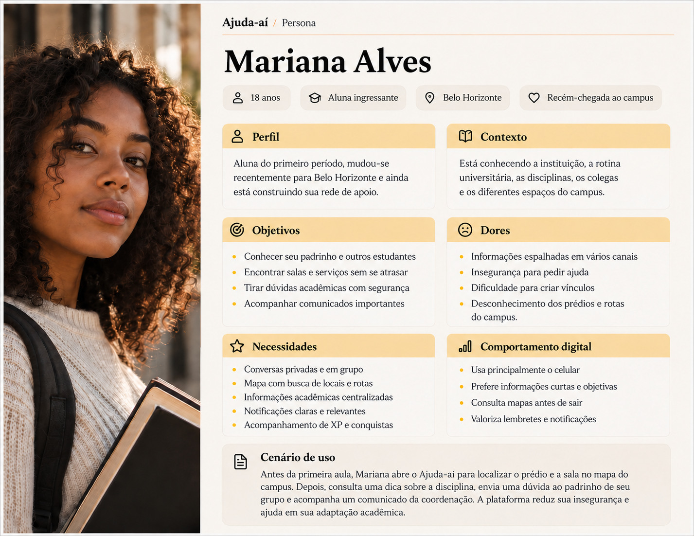
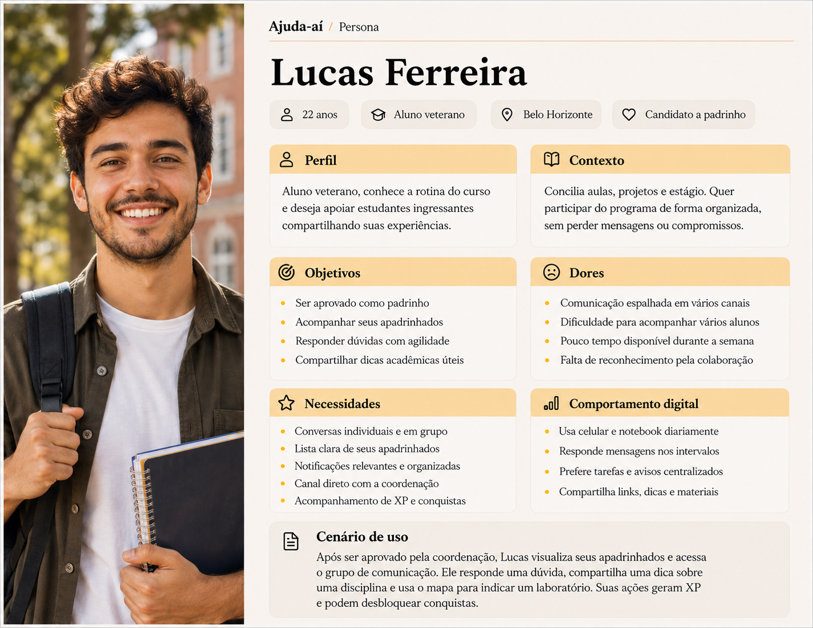
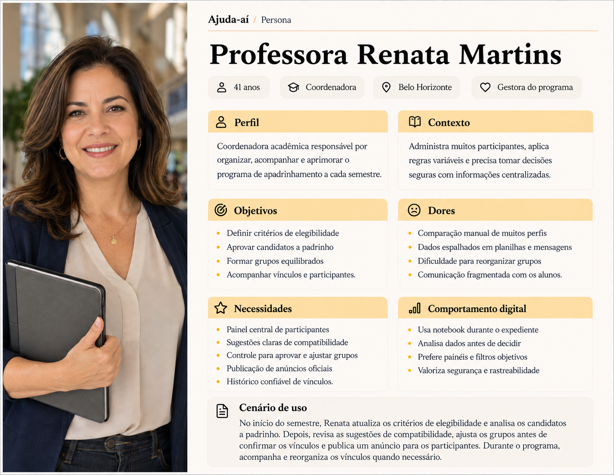

# 2. Nosso Produto

Esta seção apresenta a visão do **Ajuda-aí**, delimita as responsabilidades da plataforma e descreve os seus principais perfis de usuários.

## 2.1 Visão do Produto

O **Ajuda-aí** é uma plataforma de acolhimento e integração acadêmica baseada em um programa de apadrinhamento entre alunos ingressantes e veteranos. Seu propósito é apoiar o estudante durante sua adaptação ao curso, aproximando pessoas que podem compartilhar experiências, esclarecer dúvidas e contribuir para a construção de vínculos dentro da universidade.

A plataforma funciona como um ponto de encontro entre apadrinhados, padrinhos e coordenação. Além de apoiar a formação e o acompanhamento dos grupos, ela reúne comunicação, orientações acadêmicas, comunicados e um mapa que auxilia na localização e no deslocamento dentro do campus. Dessa forma, o Ajuda-aí não se limita a estabelecer um vínculo inicial, mas acompanha a adaptação do estudante e a relação de apadrinhamento ao longo do semestre.

Para os ingressantes, o produto representa uma referência de apoio e pertencimento. Para os veteranos, oferece uma maneira organizada de colaborar com a comunidade acadêmica. Para a coordenação, proporciona uma visão centralizada do programa e maior segurança na tomada de decisões. Assim, o Ajuda-aí busca tornar a chegada à universidade mais acolhedora, participativa e conectada.

### Diferenciais do produto

O Ajuda-aí acompanha o apadrinhamento desde a seleção dos padrinhos e a formação dos grupos. Depois que os vínculos são criados, os participantes continuam utilizando a plataforma para conversar, compartilhar informações e acompanhar as atividades do programa durante o semestre.

A formação dos grupos utiliza critérios configuráveis para sugerir combinações entre padrinhos e apadrinhados. A coordenação pode analisar, aprovar ou modificar essas sugestões antes da criação dos vínculos. Além disso, a plataforma reúne comunicação, anúncios, informações sobre disciplinas, gamificação e mapa do campus em um único ambiente, oferecendo ao ingressante apoio acadêmico, social e espacial.

## 2.2 Nosso Produto

| **É** | **Não é** |
| --- | --- |
| Uma plataforma de apadrinhamento acadêmico | Um sistema que substitui a decisão da coordenação |
| Um ambiente de comunicação entre apadrinhados, padrinhos e coordenação | Uma rede social aberta ao público externo |
| Uma ferramenta de apoio à formação de grupos por compatibilidade | Um algoritmo que cria vínculos automaticamente |
| Um espaço para comunicados, informações de disciplinas, dicas e experiências | Um sistema institucional para matrícula, notas ou frequência |
| Uma ferramenta de localização e orientação dentro do campus | Somente um aplicativo de mapas ou de mensagens |
| Um sistema de incentivo à participação por meio de gamificação | Um substituto para atendimento pedagógico, psicológico ou administrativo |

| **Faz** | **Não faz** |
| --- | --- |
| Gerencia participantes, grupos e vínculos de apadrinhamento | Forma vínculos automaticamente sem aprovação da coordenação |
| Sugere combinações entre padrinhos e apadrinhados | Substitui a análise e a decisão da coordenação |
| Oferece conversas privadas e grupos com mensagens em tempo real | Funciona como uma rede social pública |
| Centraliza anúncios, informações sobre disciplinas, dicas e experiências | Realiza matrículas ou administra notas e frequência |
| Disponibiliza um mapa para auxiliar a localização no campus | Substitui os sistemas acadêmicos oficiais da instituição |
| Utiliza XP, níveis, conquistas e notificações para incentivar a participação | Substitui atendimentos pedagógicos, psicológicos ou administrativos |

## 2.3 Personas

As personas a seguir representam os três perfis definidos para o Ajuda-aí e apresentam suas principais características, necessidades e formas de interação com a plataforma.

### Persona 1: Apadrinhada

| Campo | Descrição |
| --- | --- |
| **Nome** | Mariana Alves |
| **Idade** | 18 anos |
| **Perfil** | Aluna ingressante, recém-chegada a Belo Horizonte para iniciar o curso |
| **Contexto** | Ainda não conhece bem a instituição, as disciplinas, os colegas ou os espaços do campus |
| **Objetivos** | Conhecer seu padrinho, tirar dúvidas, receber orientações, localizar salas e acompanhar comunicados |
| **Dores** | Informações dispersas, insegurança para pedir ajuda, dificuldade para criar vínculos e desconhecimento do campus |
| **Necessidades** | Visualizar seu padrinho, conversar em privado ou no grupo, consultar informações acadêmicas, usar o mapa e acompanhar XP, nível e conquistas |
| **Motivação** | Sentir-se acolhida e adaptar-se mais rapidamente à vida acadêmica |

**Cenário de uso:** antes de sua primeira aula, Mariana acessa o mapa do Ajuda-aí para localizar o prédio e a sala. Depois, consulta dicas sobre uma disciplina e envia uma dúvida ao padrinho de seu grupo. Ela recebe um anúncio da coordenação e acompanha o XP obtido por sua participação na plataforma.

### Persona 2: Padrinho

| Campo | Descrição |
| --- | --- |
| **Nome** | Lucas Ferreira |
| **Idade** | 22 anos |
| **Perfil** | Aluno veterano interessado em apoiar estudantes ingressantes |
| **Contexto** | Conhece o curso e deseja compartilhar sua experiência, conciliando o programa com os estudos |
| **Objetivos** | Ser aprovado como padrinho, conhecer seus apadrinhados, responder dúvidas e compartilhar dicas |
| **Dores** | Comunicação distribuída em várias ferramentas, dificuldade de acompanhar diferentes alunos e pouco reconhecimento pela colaboração |
| **Necessidades** | Visualizar apadrinhados, participar de conversas e grupos, comunicar-se com a coordenação, compartilhar dicas e acompanhar recompensas |
| **Motivação** | Ajudar outros estudantes, fortalecer a comunidade acadêmica e ter sua participação reconhecida |

**Cenário de uso:** após ser aprovado pela coordenação, Lucas visualiza os ingressantes vinculados a ele e acessa o grupo de apadrinhamento. Ele responde mensagens, compartilha uma dica sobre uma disciplina e usa o mapa para indicar a localização de um laboratório. Suas ações relevantes geram XP e podem desbloquear conquistas.

### Persona 3: Coordenadora

| Campo | Descrição |
| --- | --- |
| **Nome** | Professora Renata Martins |
| **Idade** | 41 anos |
| **Perfil** | Coordenadora responsável pela organização do programa de apadrinhamento |
| **Contexto** | Precisa administrar muitos participantes e aplicar regras que podem variar a cada semestre |
| **Objetivos** | Definir critérios, aprovar padrinhos, formar grupos, acompanhar vínculos e publicar anúncios |
| **Dores** | Comparação manual de perfis, dados dispersos, dificuldade para alterar grupos e comunicação fragmentada |
| **Necessidades** | Configurar elegibilidade e compatibilidade, analisar sugestões, administrar grupos e vínculos e comunicar-se com os participantes |
| **Motivação** | Oferecer um programa de acolhimento organizado, seguro e efetivo |

**Cenário de uso:** no início do semestre, Renata atualiza os critérios de elegibilidade e analisa os candidatos a padrinho. Em seguida, recebe sugestões de compatibilidade, revisa os resultados e ajusta os grupos antes de confirmar os vínculos. Durante o semestre, publica anúncios e acompanha os participantes do programa.
