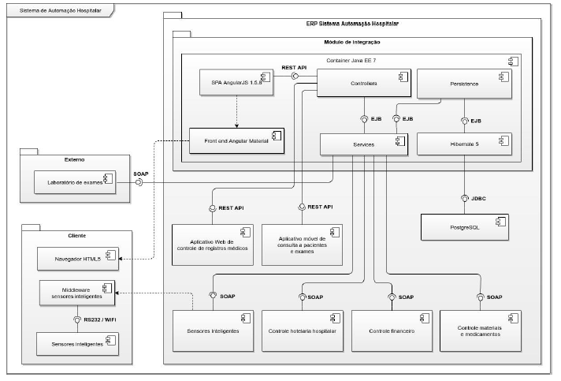

# 4. Modelagem e Projeto Arquitetural

## Visão Geral da Solução

O sistema **Ajuda-aí** é uma plataforma acadêmica projetada para conectar alunos ingressantes a veteranos. A solução foi desenhada utilizando uma arquitetura orientada a microsserviços, visando alta disponibilidade, escalabilidade e separação de domínios lógicos. A comunicação do sistema opera de forma híbrida: requisições síncronas para operações CRUD padronizadas e mensageria assíncrona orientada a eventos para processos em segundo plano e em tempo real, entregando uma experiência instantânea ao usuário sem onerar o servidor.

**Figura 1 – Macroarquitetura do sistema Ajuda-aí. Fonte: elaboração própria.**

### Explicação da Macroarquitetura

O diagrama apresenta o fluxo de dados dividido nas seguintes camadas estruturais:

- **Camada de Clientes:** composta por um aplicativo móvel e um painel web, ambos desenvolvidos em React, que atuam como interfaces de acesso ao sistema para apadrinhados, padrinhos e coordenadores.
- **Camada de Borda (API Gateway):** funciona como o único ponto de entrada público da aplicação. Centraliza a autenticação e a segurança, além de realizar o roteamento reverso do tráfego HTTP para o microsserviço correspondente.
- **Microsserviços de Negócio:** constituem o núcleo da aplicação, desenvolvido em Spring Boot e segmentado nos domínios independentes de Usuários, Matching (avaliação de compatibilidade), Feed, Mapa e Rotas, Mensagens e Gamificação (cálculo de XP e níveis).
- **Mensageria Assíncrona (RabbitMQ):** atua como o *message broker* do sistema. Desacopla os serviços ao receber eventos, como “nova mensagem enviada” ou “totem girado”, e distribuí-los aos módulos interessados, evitando que um serviço precise aguardar a resposta de outro.
- **Tempo Real (Gateway SSE):** microsserviço responsável por manter conexões unidirecionais com os clientes por meio de *Server-Sent Events* (SSE). Consome eventos do RabbitMQ e envia conversas privadas e notificações diretamente à interface do usuário, sem recarregar a página e sem depender de WebSockets.
- **Camada de Persistência:** utiliza um banco de dados relacional PostgreSQL centralizado, com isolamento lógico por meio de um *schema* para cada microsserviço. Arquivos pesados, como fotos de perfil e mídias do feed, são armazenados em um serviço externo de *Object Storage*, otimizando o tráfego da API.

## 4.1. Histórias de Usuário

_Nesta seção, você deve descrever estórias de usuários seguindo os métodos ágeis. Lembre-se das características de qualidade das estórias de usuários, ou seja, o que é preciso para descrever boas histórias de usuários._

Exemplos de Histórias de Usuário:

- Como Fulano eu quero poder convidar meus amigos para que a gente possa se reunir...

- Como Cicrano eu quero poder organizar minhas tarefas diárias, para que...

- Como gerente eu quero conseguir entender o progresso do trabalho do meu time, para que eu possa ter relatórios periódicos dos nossos acertos e falhas.

|EU COMO... `PERSONA`| QUERO/PRECISO ... `FUNCIONALIDADE` |PARA ... `MOTIVO/VALOR`                 |
|--------------------|------------------------------------|----------------------------------------|
|Usuário do sistema  | Registrar minhas tarefas           | Não esquecer de fazê-las               |
|Administrador       | Alterar permissões                 | Permitir que possam administrar contas |

## 4.2. Visão Lógica

_Apresente os artefatos que serão utilizados descrevendo em linhas gerais as motivações que levaram a equipe a utilizar estes diagramas._

### Diagrama de Classes

**Figura 2 – Diagrama de classes (exemplo). Fonte: o próprio autor.**

Obs: Acrescente uma breve descrição sobre o diagrama apresentado na Figura 3.

### Diagrama de componentes

_Apresente o diagrama de componentes da aplicação, indicando, os elementos da arquitetura e as interfaces entre eles. Liste os estilos/padrões arquiteturais utilizados e faça uma descrição sucinta dos componentes indicando o papel de cada um deles dentro da arquitetura/estilo/padrão arquitetural. Indique também quais componentes serão reutilizados (navegadores, SGBDs, middlewares, etc), quais componentes serão adquiridos por serem proprietários e quais componentes precisam ser desenvolvidos._

**Figura 3 – Diagrama de Componentes (exemplo). Fonte: o próprio autor.**

_Apresente uma descrição detalhada dos artefatos que constituem o diagrama de implantação._

Ex: conforme diagrama apresentado na Figura X, as entidades participantes da solução são:

- **Componente 1** - Lorem ipsum dolor sit amet, consectetur adipiscing elit. Cras nunc magna, accumsan eget porta a, tincidunt sed mauris. Suspendisse orci nulla, sagittis a lorem laoreet, tincidunt imperdiet ipsum. Morbi malesuada pretium suscipit.
- **Componente 2** - Praesent nec nisi hendrerit, ullamcorper tortor non, rutrum sem. In non lectus tortor. Nulla vel tincidunt eros.

## 4.3. Modelo de dados (opcional)

_Caso julgue necessário para explicar a arquitetura, apresente o diagrama de classes ou diagrama de Entidade/Relacionamentos ou tabelas do banco de dados. Este modelo pode ser essencial caso a arquitetura utilize uma solução de banco de dados distribuídos ou um banco NoSQL._

 ")

**Figura 4 – Diagrama de Entidade Relacionamento (ER) - exemplo. Fonte: o próprio autor.**

Obs: Acrescente uma breve descrição sobre o diagrama apresentado na Figura 3.
