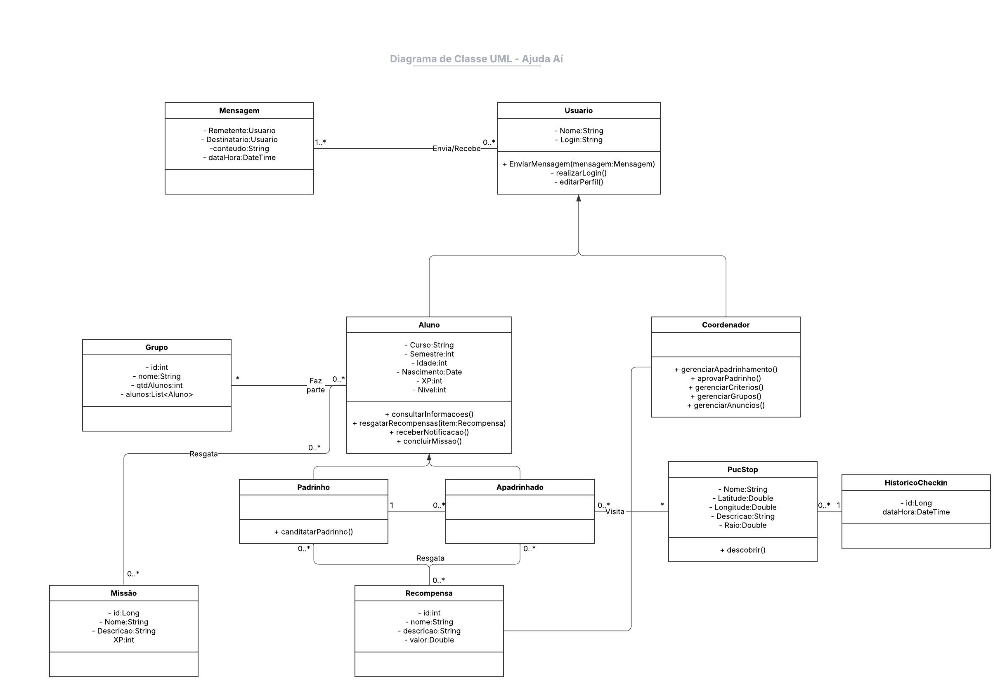
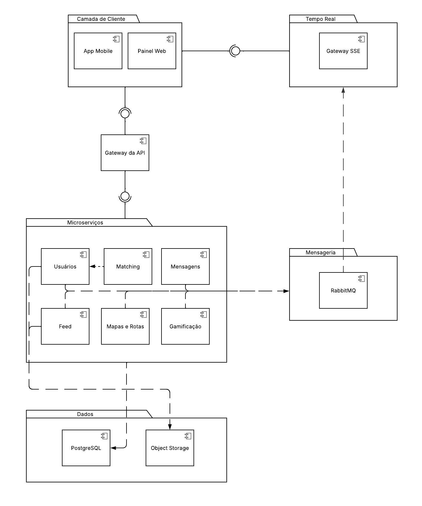

# 4. Modelagem e Projeto Arquitetural

## Visão Geral da Solução

O sistema **Ajuda-aí** é uma plataforma acadêmica projetada para conectar alunos ingressantes a veteranos. A solução foi desenhada utilizando uma arquitetura orientada a microsserviços, visando alta disponibilidade, escalabilidade e separação de domínios lógicos. A comunicação do sistema opera de forma híbrida: requisições síncronas para operações CRUD padronizadas e mensageria assíncrona orientada a eventos para processos em segundo plano e em tempo real, entregando uma experiência instantânea ao usuário sem onerar o servidor.

**Figura 1 – Macroarquitetura do sistema Ajuda-aí. Fonte: elaboração própria.**

### Explicação da Macroarquitetura

O diagrama apresenta o fluxo de dados dividido nas seguintes camadas estruturais:

- **Camada de Clientes:** composta por um aplicativo móvel e um painel web, ambos desenvolvidos em React, que atuam como interfaces de acesso ao sistema para apadrinhados, padrinhos e coordenadores.
- **Camada de Borda (API Gateway):** funciona como o único ponto de entrada público da aplicação. Centraliza a autenticação e a segurança, além de realizar o roteamento reverso do tráfego HTTP para o microsserviço correspondente.
- **Microsserviços de Negócio:** constituem o núcleo da aplicação, desenvolvido em Spring Boot e segmentado nos domínios independentes de Usuários, Matching (avaliação de compatibilidade), Feed, Mapa e Rotas, Mensagens e Gamificação (cálculo de XP e níveis).
- **Mensageria Assíncrona (RabbitMQ):** atua como o *message broker* do sistema. Desacopla os serviços ao receber eventos, como “nova mensagem enviada” ou “totem girado”, e distribuí-los aos módulos interessados, evitando que um serviço precise aguardar a resposta de outro.
- **Tempo Real (Gateway SSE):** microsserviço responsável por manter conexões unidirecionais com os clientes por meio de *Server-Sent Events* (SSE). Consome eventos do RabbitMQ e envia conversas privadas e notificações diretamente à interface do usuário, sem recarregar a página e sem depender de WebSockets.
- **Camada de Persistência:** utiliza um banco de dados relacional PostgreSQL centralizado, com isolamento lógico por meio de um *schema* para cada microsserviço. Arquivos pesados, como fotos de perfil e mídias do feed, são armazenados em um serviço externo de *Object Storage*, otimizando o tráfego da API.

## 4.1. Histórias de Usuário

|EU COMO... `PERSONA`| QUERO/PRECISO ... `FUNCIONALIDADE` |PARA ... `MOTIVO/VALOR` |
|--------------------|------------------------------------|----------------------------------------|
| Usuário do sistema | Realizar login na plataforma com minhas credenciais | Acessar a interface e funcionalidades específicas do meu perfil |
| Usuário do sistema | Visualizar e editar minhas informações de perfil | Manter meus dados atualizados e ser identificado pelos outros participantes |
| Usuário do sistema | Visualizar meu nível atual, total de XP e conquistas no meu perfil | Acompanhar meu progresso e engajamento no programa |
| Coordenador | Definir e alterar os critérios de elegibilidade para candidatos a padrinhos | Ajustar os requisitos de seleção de acordo com o semestre vigente |
| Coordenador | Visualizar a lista de alunos candidatos a padrinhos e aprová-los ou rejeitá-los | Garantir que apenas alunos veteranos qualificados atuem no programa |
| Coordenador | Selecionar critérios para avaliar a compatibilidade entre padrinhos e apadrinhados | Gerar sugestões de combinações alinhadas às necessidades do semestre |
| Coordenador | Receber sugestões automáticas de compatibilidade entre padrinhos e apadrinhados | Ter uma base automatizada para a formação dos grupos |
| Coordenador | Aprovar, rejeitar ou modificar sugestões e criar/alterar grupos de apadrinhamento manualmente | Garantir a melhor formação de equipes respeitando o limite por padrinho |
| Apadrinhado ou Padrinho | Visualizar a quem estou vinculado (padrinho ou apadrinhados) | Saber quem faz parte do meu grupo de apadrinhamento |
| Usuário do sistema | Iniciar conversas privadas com meus pares autorizados | Tirar dúvidas e trocar informações individualmente com privacidade |
| Padrinho ou Apadrinhado | Ter acesso aos grupos automáticos de comunicação da minha equipe ou de padrinhos/coordenação | Ter um canal centralizado para troca de informações coletivas |
| Participante de grupo | Enviar/receber mensagens em tempo real e consultar o histórico de conversas | Manter uma comunicação fluida e assíncrona sem perda de contexto |
| Usuário do sistema | Receber notificações sobre mensagens não lidas, anúncios ou eventos do programa | Não perder atualizações importantes e prazos do programa |
| Coordenador | Publicar, editar e excluir anúncios no feed oficial | Manter todos os participantes informados sobre comunicados do programa |
| Aluno | Visualizar informações e detalhes sobre as disciplinas do curso | Me planejar academicamente e auxiliar outros colegas de forma assertiva |
| Aluno | Compartilhar dicas e experiências sobre as disciplinas do curso | Ajudar outros colegas em seu progresso e desenvolvimento acadêmico |
| Usuário do sistema | Acumular XP e subir de nível automaticamente ao realizar ações no sistema | Ser incentivado a me engajar de forma recorrente na plataforma |
| Usuário do sistema | Ser notificado ao atingir os critérios para desbloquear uma conquista | Acompanhar minhas conquistas e me sentir motivado a continuar participando |

## 4.2. Visão Lógica

### Diagrama de Classes

**Figura 2 – Diagrama de classes. Fonte: Arthur Henrique.**
    
Diagrama de Classes UML – O diagrama de classes apresenta a estrutura lógica e comportamental da aplicação, identificando as principais classes, seus atributos, métodos e relacionamentos. A classe Usuário representa a base para os diferentes perfis do sistema, sendo especializada pelas classes Aluno e Coordenador. O modelo também contempla classes como Grupo, Mensagem, Padrinho, Apadrinhado, Missão, Recompensa, PontoStop e HistóricoCheckin, representando funcionalidades relacionadas à comunicação, gamificação, apadrinhamento e exploração de pontos de interesse. Além dos atributos, são apresentados métodos que representam operações disponíveis em determinadas classes, permitindo visualizar como os objetos da aplicação interagem e quais responsabilidades são atribuídas a cada componente.

### Diagrama de componentes

**Figura 3 – Diagrama de Componentes . Fonte: Luiz Arthur.**

Conforme o diagrama apresentado na Figura 3, as entidades participantes da solução estão organizadas em camadas, representando a interação entre os clientes, os gateways de acesso, os microsserviços, os mecanismos de mensageria e os componentes responsáveis pelo armazenamento dos dados. A arquitetura é baseada em uma abordagem de microsserviços, na qual as principais funcionalidades do sistema são distribuídas entre componentes independentes.

App Mobile - Componente responsável por disponibilizar a aplicação para dispositivos móveis. Permite que os usuários interajam com as funcionalidades da solução, realizando operações como acesso aos recursos do sistema, visualização de informações e comunicação com os serviços disponibilizados pela API.

Painel Web - Componente responsável pela interface web da solução. Disponibiliza, por meio de um navegador, as funcionalidades do sistema para os usuários, realizando requisições aos serviços da aplicação por meio do Gateway da API.

Gateway da API - Componente responsável por atuar como ponto de entrada das requisições provenientes do aplicativo móvel e do painel web. Sua função é encaminhar as solicitações aos microsserviços correspondentes, centralizando o acesso à API e proporcionando uma camada de comunicação entre os clientes e os serviços internos da aplicação.

Gateway SSE - Componente responsável pela comunicação em tempo real utilizando Server-Sent Events (SSE). Mantém uma comunicação contínua com os clientes para permitir o envio de atualizações do servidor, como novas mensagens ou alterações relevantes, sem que seja necessário que o cliente realize requisições periódicas.

Usuários - Microsserviço responsável pelo gerenciamento das informações e operações relacionadas aos usuários da plataforma. Atua como um dos principais serviços da aplicação, fornecendo funcionalidades relacionadas ao cadastro, consulta e manutenção dos dados dos usuários.

Matching - Microsserviço responsável pelas funcionalidades de correspondência entre usuários. Processa as informações necessárias para identificar possíveis correspondências de acordo com as regras de negócio definidas pela aplicação.

Mensagens - Microsserviço responsável pelo gerenciamento das mensagens trocadas entre os usuários. É responsável por processar as operações relacionadas ao envio, recebimento e armazenamento das mensagens, utilizando o sistema de mensageria para possibilitar uma comunicação assíncrona entre os componentes.

Feed - Microsserviço responsável pelo gerenciamento do conteúdo apresentado no feed da aplicação. Processa as informações necessárias para disponibilizar aos usuários publicações e demais conteúdos relevantes de acordo com as regras da plataforma.

Mapas e Rotas - Microsserviço responsável pelas funcionalidades relacionadas à localização geográfica, mapas e cálculo de rotas. Fornece os recursos necessários para operações que dependem de informações de posicionamento e deslocamento.

Gamificação - Microsserviço responsável pelas funcionalidades de gamificação da plataforma. Gerencia elementos como pontuações, conquistas, recompensas ou outras mecânicas utilizadas para incentivar a interação dos usuários com o sistema.

RabbitMQ - Componente responsável pela infraestrutura de mensageria da solução. Atua como intermediário na troca assíncrona de mensagens entre os microsserviços e os demais componentes interessados. Essa abordagem permite desacoplar os serviços e possibilita que determinadas operações sejam processadas de forma assíncrona.

PostgreSQL - Componente responsável pelo armazenamento estruturado dos dados da aplicação. É utilizado pelos microsserviços para persistir informações relacionadas às entidades e regras de negócio do sistema, oferecendo um mecanismo de armazenamento relacional para os dados transacionais.

Object Storage - Componente responsável pelo armazenamento de objetos e arquivos utilizados pela aplicação. É adequado para dados não estruturados, como imagens, documentos e outros arquivos que não precisam ser armazenados diretamente no banco de dados relacional.

De forma geral, o App Mobile e o Painel Web constituem a camada de apresentação e acessam os serviços da aplicação por meio do Gateway da API. Os microsserviços concentram as regras de negócio da solução e utilizam o PostgreSQL e o Object Storage para persistência de dados. O RabbitMQ fornece a comunicação assíncrona entre os componentes, enquanto o Gateway SSE possibilita a entrega de informações em tempo real aos clientes. Essa organização promove baixo acoplamento, separação de responsabilidades e maior facilidade de evolução e escalabilidade dos componentes da solução.

## 4.3. Modelo de dados (opcional)

 ")

**Figura 4 – Diagrama de Entidade Relacionamento (ER) . Fonte: Luiz Arthur.**

Diagrama Entidade-Relacionamento (DER) – O DER representa a estrutura de dados da aplicação, apresentando as principais entidades, seus atributos, chaves primárias e estrangeiras e os relacionamentos entre elas. Entre as principais entidades estão Aluno, Totem, Totem Descoberto, Conquista, Conquista Obtida, Matching, Chat, Chat_Participante, Mensagem, Postagem e Coordenador. O modelo evidencia, por exemplo, o relacionamento entre alunos e totens descobertos, conquistas obtidas pelos alunos, participantes de chats e mensagens trocadas. Dessa forma, o diagrama descreve como as informações do sistema são organizadas e relacionadas no banco de dados.
