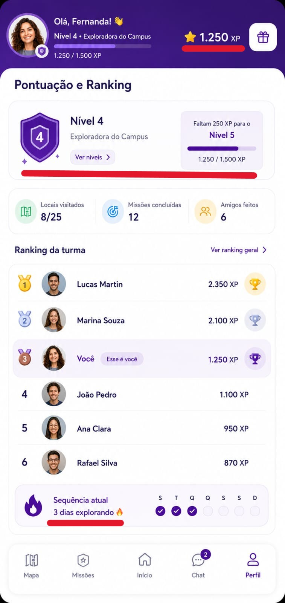
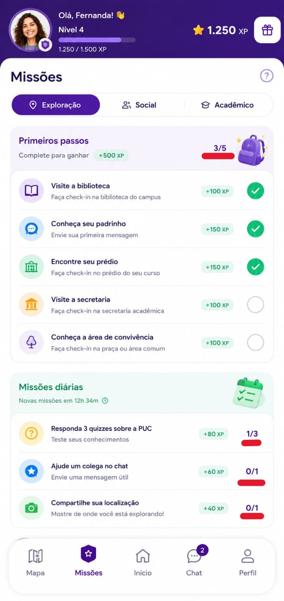
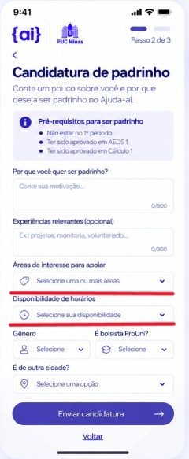
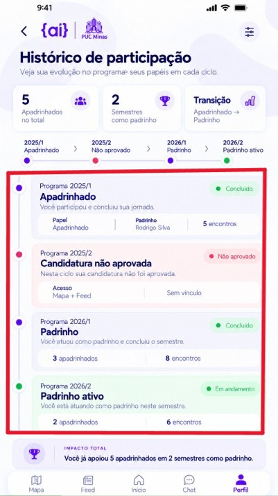
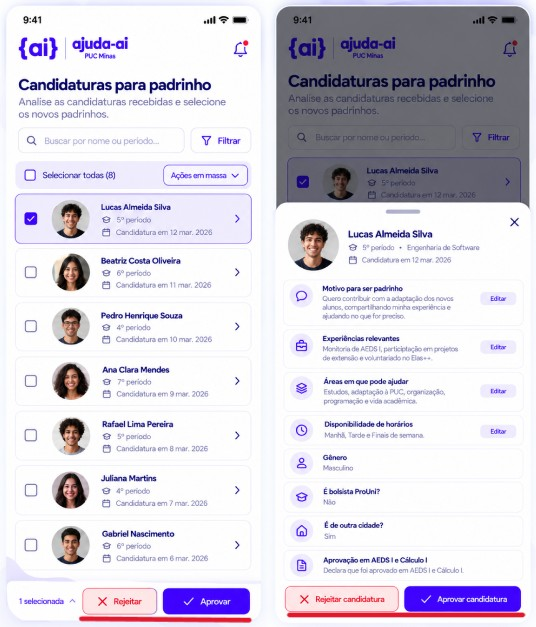
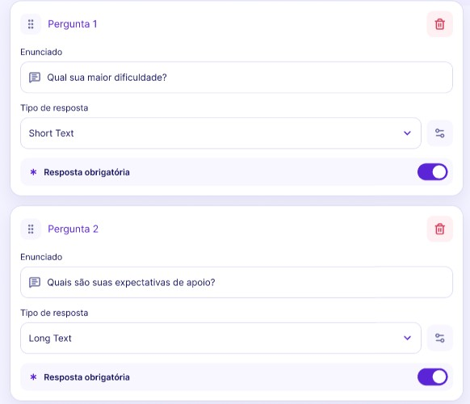
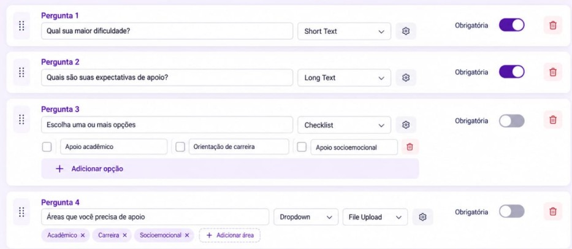
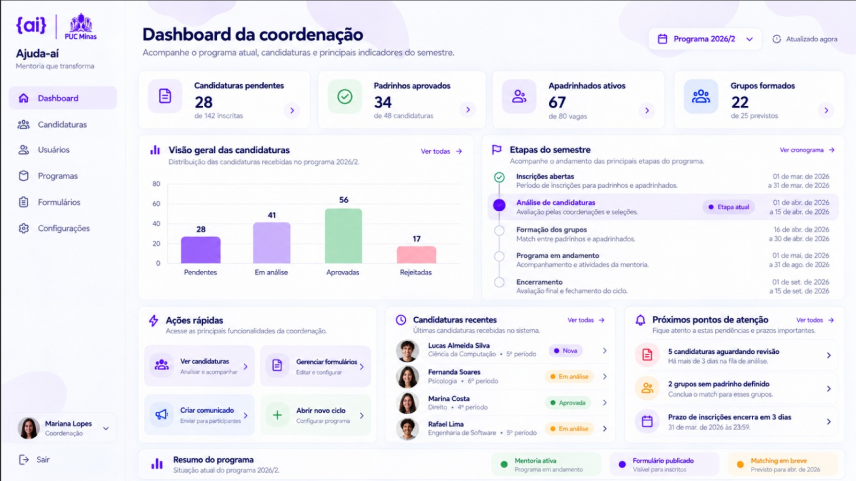
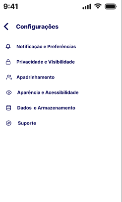

# Avaliação Heurística

**Aplicação:** Ajuda-Aí — Aplicação gamificada de integração de calouros da PUC Minas

---

## 1. Introdução

### Objetivo da análise

Analisar a usabilidade da aplicação Ajuda-Aí, uma aplicação mobile gamificada desenvolvida com o objetivo de auxiliar alunos ingressantes da PUC Minas a conhecerem o ambiente acadêmico, seus espaços, serviços e outros alunos. A aplicação utiliza mecânicas de gamificação, como missões, pontos de experiência (XP), níveis, ranking e sequência de atividades, para estimular a exploração e a interação dos estudantes.

### Cenário da análise

A análise considera um aluno calouro utilizando a aplicação Ajuda-Aí durante seus primeiros dias na universidade. O usuário acessa a aplicação utilizando sua credencial institucional da PUC Minas e, a partir da tela inicial, pode visualizar seu progresso, consultar missões, explorar locais da universidade, conversar com outros alunos e receber informações.

Durante a utilização, o aluno pode realizar missões como visitar a biblioteca, conhecer seu prédio, visitar a secretaria e conhecer áreas de convivência. Ao completar essas atividades, recebe pontos de experiência (XP), podendo subir de nível e acompanhar sua posição no ranking da turma.

A aplicação também apresenta funcionalidades sociais, como conversas com outros alunos e interação com um padrinho, além de apresentar notificações, eventos e outras informações relacionadas à universidade.

### Metodologia do estudo

O estudo foi realizado por meio de uma avaliação heurística baseada nas 10 heurísticas de usabilidade propostas por Jakob Nielsen. As telas foram analisadas individualmente, considerando as principais tarefas que um aluno calouro executaria na aplicação.

Foram identificados problemas relacionados à clareza das informações, navegação, feedback do sistema, prevenção de erros, compreensão das mecânicas de gamificação e organização das informações apresentadas ao usuário.

### Heurísticas

Foram utilizadas na avaliação as seguintes heurísticas:

1. Visibilidade do estado do sistema
2. Correspondência entre o sistema e o mundo real
3. Controle e liberdade do usuário
4. Consistência e padronização
5. Prevenção de erros
6. Reconhecimento em vez de memorização
7. Flexibilidade e eficiência de uso
8. Projeto estético e minimalista
9. Apoio ao reconhecimento, diagnóstico e recuperação de erros
10. Ajuda e documentação

---

## 2. Avaliadores

1. Arthur Henrique de Lima Santos

---

## 3. Principais Problemas

## 3. Principais Problemas

| #      | Problema / Título | Severidade | Heurísticas Violadas | Acesso Rápido |
| ------ | ----------------- | ---------- | -------------------- | :-----------: |
| **01** | Feedback durante o login | Pequeno | 1 | [Ver Detalhes](#problema-01) |
| **02** | Falta de clareza sobre o funcionamento do check-in | Grande | 1, 5, 10 | [Ver Detalhes](#problema-02) |
| **03** | Falta de informações sobre XP, níveis e sequência | Pequeno | 6, 10 | [Ver Detalhes](#problema-03) |
| **04** | Excesso de informações na tela inicial | Pequeno | 8 | [Ver Detalhes](#problema-04) |
| **05** | Falta de clareza sobre o compartilhamento de localização | Grande | 1, 5, 10 | [Ver Detalhes](#problema-05) |
| **06** | Falta de feedback em ações de missão | Pequeno | 1 | [Ver Detalhes](#problema-06) |
| **07** | Falta de diferenciação visual entre informações principais e secundárias | Pequeno | 8 | [Ver Detalhes](#problema-07) |
| **08** | Ausência de estados de erro nas funcionalidades | Grande | 1, 9 | [Ver Detalhes](#problema-08) |
| **09** | Dependência de conhecimento prévio sobre mecânicas de gamificação | Pequeno | 2, 6, 10 | [Ver Detalhes](#problema-09) |
| **10** | Dificuldade na seleção e visualização de múltiplas opções no formulário de candidatura | Pequeno | 4, 7 | [Ver Detalhes](#problema-10) |
| **11** | Falta de clareza no progresso e tempo do status da candidatura | Pequeno | 1, 6 | [Ver Detalhes](#problema-11) |
| **12** | Sobrecarga visual e alta densidade de informação no histórico de ciclos | Pequeno | 6, 8 | [Ver Detalhes](#problema-12) |
| **13** | Ações críticas sem confirmação prévia no gerenciamento de candidaturas | Grande | 3, 5 | [Ver Detalhes](#problema-13) |
| **14** | Ausência de proteção ao deletar perguntas e inconsistência de idioma no construtor de formulários | Grande | 2, 4, 5 | [Ver Detalhes](#problema-14) |
| **15** | Excesso de informação e baixa hierarquia de prioridades no Dashboard da Coordenação | Pequeno | 6, 8 | [Ver Detalhes](#problema-15) |
| **16** | Opções genéricas sem contexto ou estado no menu de configurações | Pequeno | 6, 10 | [Ver Detalhes](#problema-16) |

---

### Problema 01

| Campo | Detalhes |
| --- | --- |
| **Número do Problema** | 1 |
| **Avaliadores** | **1:** [ X ] |
| **Atividade** | Realizar login na aplicação |
| **Problema** | A tela de login apresenta o botão "Entrar com a Microsoft", porém não apresenta informações sobre o estado do sistema durante o processo de autenticação. Caso o usuário pressione o botão e o processo de login demore alguns segundos, não há indicação visual, na tela apresentada, de que a autenticação está sendo processada. Isso pode fazer com que o usuário tente pressionar o botão novamente ou interprete a ausência de resposta como uma falha. |
| **Heurística(s) violada(s)** | 1. Visibilidade do estado do sistema |
| **Severidade** | [ ] Catastrófico &nbsp;&nbsp; [ ] Grande &nbsp;&nbsp; [X] Pequeno &nbsp;&nbsp; [ ] Cosmético |
| **Local** | Tela de login |
| **Solução** | Adicionar um indicador de carregamento após o acionamento do botão de login e apresentar mensagens que indiquem o estado atual da autenticação, como "Autenticando..." ou "Entrando...". O botão também pode ser temporariamente desabilitado para evitar múltiplos acionamentos. |

#### Evidência(s)

[⬆ Voltar ao Sumário](#3-principais-problemas)

### Problema 02

| Campo | Detalhes |
| --- | --- |
| **Número do Problema** | 2 |
| **Avaliadores** | **1:** [ X ] |
| **Atividade** | Realizar uma missão com check-in |
| **Problema** | As missões relacionadas à visita de locais informam que o usuário deve realizar um check-in, porém as telas apresentadas não deixam claras as condições necessárias para que o check-in seja realizado. O usuário não consegue identificar, por exemplo, se deve estar exatamente no local, dentro de determinada distância ou realizar alguma ação adicional. A ausência dessas informações pode gerar dúvidas e tentativas frustradas ao executar a missão. |
| **Heurística(s) violada(s)** | 1. Visibilidade do estado do sistema 5. Prevenção de erros 10. Ajuda e documentação |
| **Severidade** | [ ] Catastrófico &nbsp;&nbsp; [X] Grande &nbsp;&nbsp; [ ] Pequeno &nbsp;&nbsp; [ ] Cosmético |
| **Local** | Tela de missões e missões apresentadas na tela inicial |
| **Solução** | Informar claramente as condições necessárias para realizar o check-in. O sistema pode apresentar a distância necessária, indicar se o usuário está próximo o suficiente e informar o motivo quando a ação não puder ser realizada. Também pode ser incluída uma explicação breve sobre como funciona o check-in na primeira utilização. |

#### Evidência(s)

[⬆ Voltar ao Sumário](#3-principais-problemas)

### Problema 03

| Campo | Detalhes |
| --- | --- |
| **Número do Problema** | 3 |
| **Avaliadores** | **1:** [ X ] |
| **Atividade** | Consultar informações de pontuação e progresso |
| **Problema** | A aplicação apresenta informações como XP, nível e sequência, porém não há uma explicação evidente sobre o significado e o funcionamento dessas mecânicas. O usuário visualiza informações como "1.250 XP", "Nível 4" e "3 dias explorando", mas precisa inferir o significado de cada elemento a partir da interface. Para um usuário que não esteja familiarizado com sistemas gamificados, isso pode gerar dúvidas sobre como os pontos são obtidos, como ocorre a evolução de nível e qual a finalidade da sequência. |
| **Heurística(s) violada(s)** | 6. Reconhecimento em vez de memorização 10. Ajuda e documentação |
| **Severidade** | [ ] Catastrófico &nbsp;&nbsp; [ ] Grande &nbsp;&nbsp; [X] Pequeno &nbsp;&nbsp; [ ] Cosmético |
| **Local** | Tela de perfil e tela inicial |
| **Solução** | Adicionar explicações curtas para os principais elementos de gamificação. Um botão "Como funciona?" ou tooltips podem explicar o significado de XP, níveis, ranking e sequência. Essas informações podem ser apresentadas principalmente no primeiro acesso do usuário para evitar sobrecarga visual. |

#### Evidência(s)

[⬆ Voltar ao Sumário](#3-principais-problemas)

### Problema 04

| Campo | Detalhes |
| --- | --- |
| **Número do Problema** | 4 |
| **Avaliadores** | **1:** [ X ] |
| **Atividade** | Consultar a tela inicial |
| **Problema** | A tela inicial apresenta simultaneamente diversas informações e ações, como quantidade de XP, progresso de nível, ranking, missão do dia, padrinho e locais para exploração. Embora todas essas informações sejam relacionadas ao objetivo da aplicação, a quantidade de elementos pode dificultar a identificação da ação mais importante, principalmente para um usuário que está utilizando o sistema pela primeira vez. |
| **Heurística(s) violada(s)** | 8. Projeto estético e minimalista |
| **Severidade** | [ ] Catastrófico &nbsp;&nbsp; [ ] Grande &nbsp;&nbsp; [X] Pequeno &nbsp;&nbsp; [ ] Cosmético |
| **Local** | Tela inicial |
| **Solução** | Reorganizar as informações de acordo com sua prioridade para o usuário. A missão principal e os próximos passos podem receber maior destaque, enquanto informações secundárias, como ranking e padrinho, podem ser agrupadas ou apresentadas em áreas de menor destaque visual. |

#### Evidência(s)

[⬆ Voltar ao Sumário](#3-principais-problemas)

### Problema 05

| Campo | Detalhes |
| --- | --- |
| **Número do Problema** | 5 |
| **Avaliadores** | **1:** [ X ] |
| **Atividade** | Realizar uma missão que utiliza localização |
| **Problema** | A missão "Compartilhe sua localização" informa ao usuário que ele deve compartilhar sua localização, porém a tela não apresenta uma explicação clara sobre a finalidade dessa ação ou sobre como a localização será utilizada. Por se tratar de uma informação relacionada à privacidade do usuário, a ausência de explicações pode gerar insegurança e dificultar a compreensão da funcionalidade. |
| **Heurística(s) violada(s)** | 1. Visibilidade do estado do sistema 5. Prevenção de erros 10. Ajuda e documentação |
| **Severidade** | [ ] Catastrófico &nbsp;&nbsp; [X] Grande &nbsp;&nbsp; [ ] Pequeno &nbsp;&nbsp; [ ] Cosmético |
| **Local** | Tela de missões, seção "Missões diárias" |
| **Solução** | Explicar claramente por que a localização é necessária, quando ela será utilizada e qual ação será realizada pelo sistema. Antes de compartilhar a localização, apresentar uma mensagem de confirmação ou explicação breve, permitindo que o usuário compreenda a funcionalidade antes de autorizar o acesso. |

#### Evidência(s)

[⬆ Voltar ao Sumário](#3-principais-problemas)

### Problema 06

| Campo | Detalhes |
| --- | --- |
| **Número do Problema** | 6 |
| **Avaliadores** | **1:** [ X ] |
| **Atividade** | Completar e acompanhar missões |
| **Problema** | A interface apresenta o progresso das missões por meio de elementos como "3/5", "1/3" e ícones de confirmação, porém nem todas as transições de estado são explicitamente descritas. O usuário consegue identificar visualmente que uma tarefa está concluída, mas não há, nas telas avaliadas, uma indicação textual clara informando o que aconteceu imediatamente após a conclusão ou quais pontos foram adicionados ao seu progresso. |
| **Heurística(s) violada(s)** | 1. Visibilidade do estado do sistema |
| **Severidade** | [ ] Catastrófico &nbsp;&nbsp; [ ] Grande &nbsp;&nbsp; [X] Pequeno &nbsp;&nbsp; [ ] Cosmético |
| **Local** | Tela de missões |
| **Solução** | Após a conclusão de uma missão, apresentar um feedback imediato, como "Missão concluída!" e "+100 XP". Também é recomendável atualizar visualmente o progresso de nível e demais indicadores relacionados à ação realizada. |

#### Evidência(s)

[⬆ Voltar ao Sumário](#3-principais-problemas)

### Problema 07

| Campo | Detalhes |
| --- | --- |
| **Número do Problema** | 7 |
| **Avaliadores** | **1:** [ X ] |
| **Atividade** | Identificar as ações prioritárias na tela inicial |
| **Problema** | A tela inicial utiliza cards e elementos visuais semelhantes para diferentes informações, como missão do dia, padrinho e locais próximos. Como esses elementos possuem destaque visual relativamente semelhante, pode não ficar imediatamente evidente qual deve ser a primeira ação do usuário. Isso é especialmente relevante em uma aplicação destinada a calouros, que podem não conhecer ainda a lógica de navegação da plataforma. |
| **Heurística(s) violada(s)** | 8. Projeto estético e minimalista |
| **Severidade** | [ ] Catastrófico &nbsp;&nbsp; [ ] Grande &nbsp;&nbsp; [X] Pequeno &nbsp;&nbsp; [ ] Cosmético |
| **Local** | Tela inicial |
| **Solução** | Estabelecer uma hierarquia visual mais clara entre os elementos. A missão principal pode ter maior destaque e ações diretamente executáveis podem possuir botões mais evidentes, enquanto conteúdos complementares podem ocupar áreas de menor prioridade visual. |

#### Evidência(s)

[⬆ Voltar ao Sumário](#3-principais-problemas)

### Problema 08

| Campo | Detalhes |
| --- | --- |
| **Número do Problema** | 8 |
| **Avaliadores** | **1:** [ X ] |
| **Atividade** | Recuperação de situações de erro |
| **Problema** | As telas apresentadas não demonstram estados de erro para funcionalidades importantes, como falha no login, impossibilidade de realizar um check-in, falha no carregamento das missões ou problemas de conexão. Como essas situações fazem parte do uso esperado de uma aplicação mobile, a ausência de feedback e mecanismos de recuperação pode deixar o usuário sem saber o que aconteceu ou como prosseguir. |
| **Heurística(s) violada(s)** | 1. Visibilidade do estado do sistema 9. Apoio ao reconhecimento, diagnóstico e recuperação de erros |
| **Severidade** | [ ] Catastrófico &nbsp;&nbsp; [X] Grande &nbsp;&nbsp; [ ] Pequeno &nbsp;&nbsp; [ ] Cosmético |
| **Local** | Fluxos de login, missões, localização e carregamento de conteúdo |
| **Solução** | Implementar mensagens de erro claras e específicas para cada situação. As mensagens devem explicar o problema e, quando possível, apresentar uma ação para recuperação, como "Tentar novamente", "Ativar localização" ou "Verificar conexão". |

#### Evidência(s)

[⬆ Voltar ao Sumário](#3-principais-problemas)

### Problema 9

| Campo | Detalhes |
| --- | --- |
| **Número do Problema** | 9 |
| **Avaliadores** | **1:** [ X ] |
| **Atividade** | Interpretar as mecânicas de gamificação da aplicação |
| **Problema** | Alguns elementos apresentados na aplicação dependem de conhecimentos prévios relacionados a sistemas gamificados. Termos e conceitos como "XP", "Nível", "Ranking" e "Sequência atual" podem ser compreendidos por usuários familiarizados com jogos, mas um usuário que não tenha esse conhecimento pode não entender imediatamente como essas mecânicas influenciam sua experiência na aplicação. |
| **Heurística(s) violada(s)** | 2. Correspondência entre o sistema e o mundo real 6. Reconhecimento em vez de memorização 10. Ajuda e documentação |
| **Severidade** | [ ] Catastrófico &nbsp;&nbsp; [ ] Grande &nbsp;&nbsp; [X] Pequeno &nbsp;&nbsp; [ ] Cosmético |
| **Local** | Tela inicial, tela de perfil e tela de missões |
| **Solução** | Utilizar pequenas descrições junto aos termos ou oferecer explicações contextuais. Por exemplo, apresentar "XP — pontos de experiência" na primeira utilização e disponibilizar uma seção explicando as regras de níveis, ranking e sequência. |

#### Evidência(s)

[⬆ Voltar ao Sumário](#3-principais-problemas)

### Problema 10

| Campo | Detalhes |
| --- | --- |
| **Número do Problema** | 10 |
| **Avaliadores** | **1:** [ X ] |
| **Atividade** | Preenchimento do formulário de candidatura a padrinho (Passo 2 de 3) |
| **Problema** | O campo "Áreas de interesse para apoiar" e outros campos, apresentam opções em formato de menu suspenso (*dropdown*), mas o formato de seleção múltipla ou a visualização dos itens selecionados pode não ser totalmente evidente ou confortável para o usuário analisar de uma só vez, exigindo cliques adicionais para verificar o que foi marcado[cite: 1]. |
| **Heurística(s) violada(s)** | 4. Consistência e padronização 7. Flexibilidade e eficiência de uso |
| **Severidade** | [ ] Catastrófico &nbsp;&nbsp; [ ] Grande &nbsp;&nbsp; [X] Pequeno &nbsp;&nbsp; [ ] Cosmético |
| **Local** | Tela de candidatura de padrinho (Passo 2 de 3) |
| **Solução** | Utilizar componentes de seleção em formato de *chips* ou pílulas (semelhantes aos já utilizados na tela de preferências de perfil em `cadastro e candidatura padrinho.jpg`), facilitando a visualização rápida e a remoção de itens selecionados[cite: 1, 3]. |

#### Evidência(s)

[⬆ Voltar ao Sumário](#3-principais-problemas)

### Problema 11

| Campo | Detalhes |
| --- | --- |
| **Número do Problema** | 11 |
| **Avaliadores** | **1:** [ X ] |
| **Atividade** | Acompanhamento do status da candidatura |
| **Problema** | A tela de status da candidatura exibe uma linha do tempo vertical com etapas (Candidatura enviada, Em análise, Resultado, Início das atividades), mas o design da interface web/mobile pode dificultar a compreensão imediata de qual etapa exata está ativa e o que o usuário precisa fazer enquanto aguarda, além de faltar um indicativo visual mais forte de tempo estimado de resposta além de um bloco de texto estático[cite: 2]. |
| **Heurística(s) violada(s)** | 1. Visibilidade do estado do sistema 6. Reconhecimento em vez de memorização |
| **Severidade** | [ ] Catastrófico &nbsp;&nbsp; [ ] Grande &nbsp;&nbsp; [X] Pequeno &nbsp;&nbsp; [ ] Cosmético |
| **Local** | Tela de status da candidatura (versão web/mobile) |
| **Solução** | Destacar visualmente a etapa atual na linha do tempo com cores contrastantes ou ícones dinâmicos mais evidentes, e fornecer um resumo em tópicos curtos sobre o que acontece em cada fase[cite: 2]. |

#### Evidência(s)

[⬆ Voltar ao Sumário](#3-principais-problemas)

### Problema 12

| Campo | Detalhes |
| --- | --- |
| **Número do Problema** | 12 |
| **Avaliadores** | **1:** [ X ] |
| **Atividade** | Visualização do histórico de participação |
| **Problema** | A tela de histórico apresenta múltiplos ciclos acadêmicos (ex: 2025/1, 2025/2, 2026/1) com cores e status variados ("Concluído", "Não aprovado", "Em andamento"), porém a densidade de informação é alta e a legenda para diferenciar os ícones de ciclos passados pode exigir esforço cognitivo excessivo do usuário para entender sua trajetória completa[cite: 4]. |
| **Heurística(s) violada(s)** | 8. Projeto estético e minimalista 6. Reconhecimento em vez de memorização |
| **Severidade** | [ ] Catastrófico &nbsp;&nbsp; [ ] Grande &nbsp;&nbsp; [X] Pequeno &nbsp;&nbsp; [ ] Cosmético |
| **Local** | Tela de histórico de participação |
| **Solução** | Agrupar os dados por cartões mais limpos e limitação de informações textuais secundárias, permitindo expandir detalhes de cada semestre apenas sob demanda (clique), aliviando a carga visual da tela[cite: 4]. |

#### Evidência(s)

[⬆ Voltar ao Sumário](#3-principais-problemas)

### Problema 13

| Campo | Detalhes |
| --- | --- |
| **Número do Problema** | 13 |
| **Avaliadores** | **1:** [ X ] |
| **Atividade** | Análise e aprovação/rejeição de candidaturas (Visão Mobile) |
| **Problema** | Na visualização mobile da gestão de candidaturas, os botões de ação destrutiva/irreversível ("Rejeitar" / "Aprovar") ficam fixos e muito próximos no rodapé da tela, além de poderem ser acionados em massa[cite: 7]. Caso o coordenador toque acidentalmente em "Aprovar" ou "Rejeitar" ao navegar na lista ou na janela modal de detalhes, não há indicação clara de uma etapa de confirmação, podendo gerar ações indesejadas[cite: 7]. |
| **Heurística(s) violada(s)** | 5. Prevenção de erros 3. Controle e liberdade do usuário |
| **Severidade** | [ ] Catastrófico &nbsp;&nbsp; [X] Grande &nbsp;&nbsp; [ ] Pequeno &nbsp;&nbsp; [ ] Cosmético |
| **Local** | Tela de Candidaturas para padrinho (Mobile)[cite: 7] |
| **Solução** | Exibir um *modal* ou diálogo de confirmação antes de efetivar aprovações ou rejeições (especialmente em lote/massa), explicando o impacto da ação e permitindo desfazer o envio se necessário[cite: 7]. |

#### Evidência(s)

[⬆ Voltar ao Sumário](#3-principais-problemas)

### Problema 14

| Campo | Detalhes |
| --- | --- |
| **Número do Problema** | 14 |
| **Avaliadores** | **1:** [ X ] |
| **Atividade** | Edição e gerenciamento do construtor de formulários |
| **Problema** | Nas telas do Gerenciador de Formulários (Web e Mobile), o ícone de exclusão de pergunta (lixeira vermelha) é exibido diretamente ao lado dos controles do campo sem nenhuma separação ou estado visual de proteção[cite: 9, 10]. Um clique acidental pode apagar uma pergunta inteira e suas opções configuradas sem pedir confirmação ou sem oferecer um botão "Desfazer"[cite: 9, 10]. Além disso, os termos em inglês ("Short Text", "Long Text", "Dropdown", "Checklist", "File Upload") quebram a consistência do idioma para os coordenadores[cite: 9, 10]. |
| **Heurística(s) violada(s)** | 5. Prevenção de erros 4. Consistência e padronização 2. Correspondência entre o sistema e o mundo real |
| **Severidade** | [ ] Catastrófico &nbsp;&nbsp; [X] Grande &nbsp;&nbsp; [ ] Pequeno &nbsp;&nbsp; [ ] Cosmético |
| **Local** | Gerenciador de Formulários (Web e Mobile)[cite: 9, 10] |
| **Solução** | Adicionar um aviso de confirmação ao excluir uma pergunta (ou permitir a restauração via "Desfazer")[cite: 9, 10]. Traduzir todos os tipos de campos para o português (ex: "Texto curto", "Texto longo", "Lista suspensa", "Envio de arquivo")[cite: 9, 10]. |

#### Evidência(s)

[⬆ Voltar ao Sumário](#3-principais-problemas)

### Problema 15

| Campo | Detalhes |
| --- | --- |
| **Número do Problema** | 15 |
| **Avaliadores** | **1:** [ X ] |
| **Atividade** | Leitura de métricas e navegação pelo Dashboard da Coordenação |
| **Problema** | O Dashboard apresenta uma alta densidade de informação reunida na mesma tela (gráficos de distribuição, progresso por etapas, cartões de resumo, ações rápidas, candidaturas recentes e avisos de atenção)[cite: 8]. Embora traga uma visão geral, a falta de espaçamento/hierarquia entre blocos com pesos visuais parecidos dificulta a identificação rápida das pendências prioritárias para o coordenador[cite: 8]. |
| **Heurística(s) violada(s)** | 8. Projeto estético e minimalista 6. Reconhecimento em vez de memorização |
| **Severidade** | [ ] Catastrófico &nbsp;&nbsp; [ ] Grande &nbsp;&nbsp; [X] Pequeno &nbsp;&nbsp; [ ] Cosmético |
| **Local** | Dashboard da coordenação (Web)[cite: 8] |
| **Solução** | Reorganizar a hierarquia visual do painel destacando o bloco de "Próximos pontos de atenção" e reduzindo o destaque de ações secundárias[cite: 8]. Permitir colapsar ou personalizar seções do dashboard de acordo com a preferência do usuário[cite: 8]. |

#### Evidência(s)

[⬆ Voltar ao Sumário](#3-principais-problemas)

### Problema 16

| Campo | Detalhes |
| --- | --- |
| **Número do Problema** | 16 |
| **Avaliadores** | **1:** [ X ] |
| **Atividade** | Navegação na tela de configurações do participante simples |
| **Problema** | A tela de Configurações lista diversas opções em formato de lista simples ("Notificação e Preferências", "Privacidade e Visibilidade", "Apadrinhamento", etc.) sem qualquer descrição contextual do que cada subseção altera[cite: 5]. Além disso, para um participante que não é nem padrinho nem apadrinhado, a opção "Apadrinhamento" pode gerar confusão sobre o que ele encontrará ali ou induzi-lo ao erro achando que já possui um vínculo[cite: 5]. |
| **Heurística(s) violada(s)** | 6. Reconhecimento em vez de memorização 10. Ajuda e documentação |
| **Severidade** | [ ] Catastrófico &nbsp;&nbsp; [ ] Grande &nbsp;&nbsp; [X] Pequeno &nbsp;&nbsp; [ ] Cosmético |
| **Local** | Tela de Configurações (Mobile)[cite: 5] |
| **Solução** | Adicionar um pequeno texto explicativo (*subtitle/caption*) abaixo do título de cada opção informando o que o usuário pode configurar[cite: 5]. Na opção "Apadrinhamento", esclarecer o status do participante (ex: "Seja um padrinho ou apadrinhado") caso ele ainda não faça parte de nenhum ciclo[cite: 5]. |

#### Evidência(s)

[⬆ Voltar ao Sumário](#3-principais-problemas)