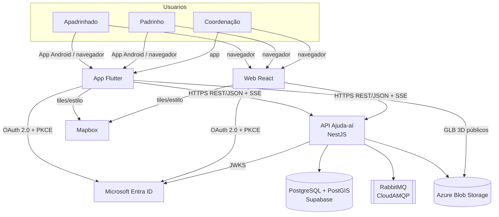
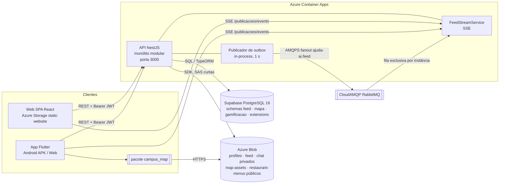
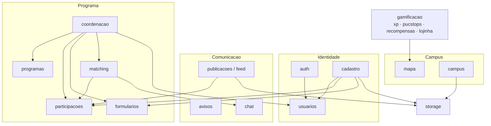
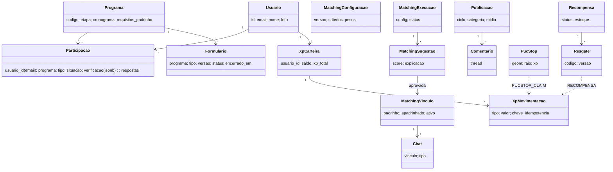
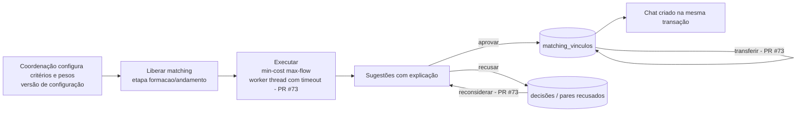
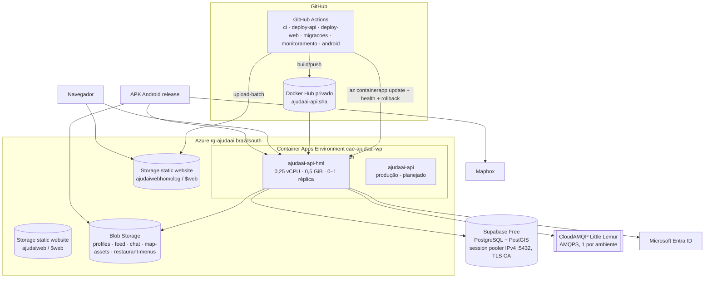
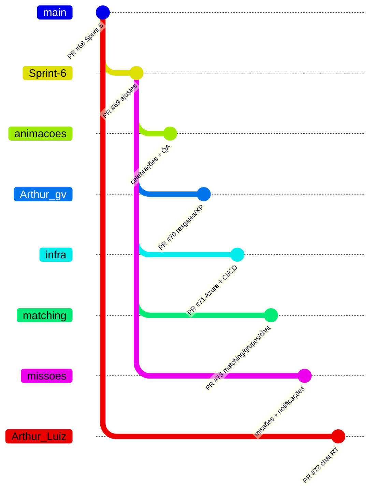

# Documento de Arquitetura de Software — Ajuda-aí

**Versão:** 1.0 final · **Data:** 24/11/2026
**Repositório:** https://github.com/ICEI-PUC-Minas-PMGES-TI/pmg-es-2026-2-ti5-6904100-ajuda-ai
**Curso:** Engenharia de Software — PUC Minas, Campus Coração Eucarístico (TI5, 2026/2)

**Equipe:** Arthur Gonçalves Vieira, Arthur Henrique de Lima Santos, Fernanda Soares Oliveira Cunha, Gabriel Lacerda Lemos, Luiz Arthur Costa e Costa, Matheus Guilherme Viana Pereira.
**Orientadores:** Leonardo Vilela Cardoso, João Paulo Carneiro Aramuni, Artur Martins Mol.

---

## Histórico de revisões

| Versão | Data | Descrição |
| --- | --- | --- |
| 0.x | set–out/2026 | Capítulos 1–5 da documentação acadêmica (`docs/1..5.*.md`): visão, requisitos, macroarquitetura planejada (microsserviços). |
| 0.9 | nov/2026 | Documentação técnica (`docs/tecnico/`): ADR-0001 a ADR-0007, feed em tempo real, migrations, mapa, gamificação. |
| **1.0** | **24/11/2026** | **Versão final consolidada.** Descreve a arquitetura **como construída**, a partir do código de todas as branches e PRs, e registra os desvios em relação à arquitetura planejada. |

## Escopo e base de análise

Este documento descreve a arquitetura **implementada** do Ajuda-aí. A análise considerou o código-fonte (não apenas a documentação) de todas as branches do repositório e de todos os pull requests (#19 a #73).

| Referência | Situação em 24/11/2026 | Papel neste documento |
| --- | --- | --- |
| `main` | Último merge: PR #68 (Sprint 5), 11/11/2026 | Versão estável entregue na Sprint 5 |
| `Sprint-6` | `main` + PR #69 (ajustes), 16 commits à frente | **Linha de base da arquitetura** (integração da Sprint 6) |
| `animacoes` | `Sprint-6` + 4 commits, sem PR | Celebração de nível, painel de QA da gamificação, ajustes de acessibilidade |
| `Arthur_gv` — PR #70 (aberto → `Sprint-6`) | `Sprint-6` + 7 | Coordenação da lojinha: entrega/cancelamento/estorno de resgates, ajustes de XP |
| `infra/hospedagem` — PR #71 (aberto → `Sprint-6`) | `Sprint-6` + 6 | Hospedagem de homologação na Azure, CI/CD, saúde, rate limit |
| `Arthur_Luiz` — PR #72 (aberto → `Sprint-6`) | `main` + 1 | Chat em tempo real com RabbitMQ, outbox, imagens e cache |
| `fix/matching-estabilizacao-parte-0-1` — PR #73 (aberto → `Sprint-6`) | `Sprint-6` + 5 | Reestruturação do matching: grupos, transferências, chat de grupo |
| `matheus-missoes` | `Sprint-6` + 15, sem PR | Missões e central de notificações |
| `Sprint-5`, `ajustes` | Já incorporadas em `main`/`Sprint-6` | Histórico |

Ao longo do texto, cada elemento é marcado como:

- **[Base]**: existe em `Sprint-6`.
- **[PR #n]** ou **[branch]**: existe apenas na branch indicada e ainda não foi integrado.

A seção 11 consolida o estado de integração e os conflitos entre branches.

---

## Sumário

1. Introdução
2. Visão geral do produto e da solução
3. Requisitos arquiteturalmente significativos
4. Restrições arquiteturais: planejado × implementado
5. Visão lógica (módulos e domínios)
6. Visão de processos (fluxos e concorrência)
7. Visão de dados
8. Visão de implantação (infraestrutura e CI/CD)
9. Mecanismos arquiteturais (transversais)
10. Decisões arquiteturais (ADRs)
11. Estado de integração das branches e riscos de merge
12. Avaliação da arquitetura (cenários de qualidade, ATAM)
13. Rastreabilidade: requisitos × implementação
14. Riscos, dívidas técnicas e recomendações
15. Referências

---

## 1. Introdução

### 1.1 Propósito

Este documento registra as decisões, estruturas e mecanismos que compõem a arquitetura do sistema **Ajuda-aí**. Serve de referência para manutenção, avaliação acadêmica e evolução do sistema. Consolida a documentação acadêmica (`docs/1..8.*.md`), a técnica (`docs/tecnico/`) e o estado real do código.

### 1.2 Problema

Alunos ingressantes têm dificuldade de se integrar ao curso e ao campus. Falta um canal estruturado entre calouros, veteranos e coordenação. Isso aumenta o isolamento e a evasão nos primeiros semestres.

### 1.3 Objetivos arquiteturais

1. **Gerenciamento e compatibilidade:** processar critérios configuráveis para sugerir vínculos entre padrinhos e apadrinhados, sempre sob decisão da coordenação.
2. **Comunicação:** feed, comunicados e conversas com atualização em tempo real.
3. **Gamificação:** XP, níveis, moedas, PucStops, lojinha e missões, com consistência contábil auditável.
4. **Campus:** mapa 2D/3D com rotas, eventos, restaurantes e pontos de interesse.

### 1.4 Definições e abreviaturas

| Termo | Significado |
| --- | --- |
| Apadrinhado | Aluno ingressante participante do programa |
| Padrinho | Veterano aprovado pela coordenação |
| Coordenador | Administra programas, ciclos, candidaturas, matching, feed e conteúdo do campus |
| Ciclo / Programa | Edição semestral do programa (`YYYY/1` ou `YYYY/2`), com etapas `inscricoes → analise → formacao → andamento → encerramento` |
| Matching | Geração de sugestões de pares padrinho–apadrinhado por critérios ponderados |
| PucStop | Totem geolocalizado no campus; a coleta presencial concede XP |
| XP / Moedas | Experiência acumulada (define o nível) e saldo gastável na lojinha (1:1 com o XP ganho) |
| Ledger | Livro-razão somente-inserção das movimentações de XP |
| Outbox | Tabela transacional de eventos pendentes de publicação no broker |
| SSE | Server-Sent Events: canal servidor → cliente sobre HTTP |
| ADR | Architecture Decision Record |
| RF / RNF / RN | Requisito funcional / não funcional / regra de negócio |

---

## 2. Visão geral do produto e da solução

O Ajuda-aí é uma plataforma de acolhimento acadêmico com três perfis:

- **Apadrinhado:** ingressante que recebe apoio.
- **Padrinho:** veterano que oferece apoio.
- **Coordenação:** administra o programa.

A solução tem três aplicações cliente e um back-end:

| Componente | Tecnologia | Usuários principais |
| --- | --- | --- |
| **API** (`code/back/api`) | Node.js, NestJS 12, TypeScript 6, TypeORM 1.1 | Todos os clientes |
| **Web** (`code/front`) | React 19, Vite 7, React Router 7, Mapbox GL JS 3 | Coordenação (completo) e alunos |
| **Mobile** (`code/mobile`) | Flutter ≥ 3.47 / Dart ≥ 3.13, pacote interno `campus_map` | Alunos (principal) e coordenação |
| **Banco** | PostgreSQL 16 + PostGIS 3.5 (Supabase em nuvem; Docker local) | API |
| **Broker** | RabbitMQ 4 (Docker local; CloudAMQP em nuvem) | API |
| **Object storage** | Azure Blob Storage | API (escrita) e clientes (leitura pública/SAS) |
| **Identidade** | Microsoft Entra ID (OAuth 2.0 + PKCE) | Login institucional `@pucminas.edu.br` |
| **Mapas** | Mapbox (basemap, estilo, camadas 3D) | Web e mobile |

### 2.1 Diagrama de contexto (C4 — nível 1)



### 2.2 Diagrama de contêineres (C4 — nível 2)



---

## 3. Requisitos arquiteturalmente significativos

### 3.1 Requisitos funcionais e situação de implementação

| ID | Requisito (resumo) | Plataforma | Situação (análise de todas as branches) |
| --- | --- | --- | --- |
| RF001 | Login e identificação do perfil | web, mobile | **Implementado [Base]**: Entra ID + JWT; login demo protegido **[PR #71]** |
| RF002 | Visualizar e editar perfil | web, mobile | **Implementado [Base]**: `/me`, foto no Blob `profiles` |
| RF003 | Critérios de elegibilidade e aprovação de padrinhos | web | **Implementado [Base]**: formulários versionados, candidaturas, verificação acadêmica (F09) |
| RF004 | Gerir vínculos | web | **Implementado [Base]**; transferência de vínculo e grupos **[PR #73]** |
| RF005 | Configurar critérios de compatibilidade | web | **Implementado [Base]**: catálogo de critérios versionado; CRUD ampliado **[PR #73]** |
| RF006 | Gerar e aprovar sugestões | web | **Implementado [Base]**: algoritmo de fluxo de custo mínimo com explicação; execução em worker thread **[PR #73]** |
| RF007 | Grupos e limite por padrinho | web, mobile | **Parcial [Base]**: capacidade por padrinho no algoritmo; grupos explícitos **[PR #73]** |
| RF008 | Chat privado/grupo em tempo real | web, mobile | **Parcial**. [Base]: chat REST por vínculo, sem tempo real; web usa mock. Duas implementações concorrentes: **[PR #72]** (RabbitMQ + SSE) e **[PR #73]** (SSE por polling, grupos) |
| RF009 | Anúncios no feed | web, mobile | **Implementado [Base]**: feed por ciclo, categoria "Comunicados", SSE |
| RF010 | Disciplinas, dicas e experiências | web, mobile | **Parcial [Base]**: publicações categorizadas no feed; sem catálogo de disciplinas |
| RF011 | Gamificação (XP, níveis, conquistas) | web, mobile | **Implementado [Base]**: 10 níveis, moedas, PucStops, lojinha. Celebração de nível **[animacoes]**, missões **[matheus-missoes]**, gestão de resgates/ajustes **[PR #70]** |
| RF012 | Notificações | web, mobile | **Parcial**. [Base]: painel de avisos (`GET /avisos`). Central de notificações **[matheus-missoes]**; sem push |
| RF013 | Mapa da PUC | web, mobile | **Implementado [Base]**: web 2D/extrusão; mobile 3D com modelos GLB, rotas e PucStops |

### 3.2 Requisitos não funcionais

| ID | Requisito | Tática adotada | Evidência |
| --- | --- | --- | --- |
| RNF001 | Autenticação e autorização por perfil | JWT HS256 de 1 h; guards de perfil; permissão de aluno derivada da participação no ciclo, não do token | `src/auth/*`, `permissoes-aluno.service.ts`, `FeedPolicy` |
| RNF002/003 | Usabilidade e adequação web/mobile | Layouts por papel; contraste AA e feed responsivo | Avaliação heurística (cap. 6); commit `30fb341` |
| RNF004 | 500 usuários simultâneos | API stateless escalável horizontalmente; fan-out de SSE via RabbitMQ entre instâncias | `feed-rabbit.service.ts`; Container Apps (0–1 réplica em homologação) |
| RNF005 | Tempo real sem recarregar | SSE com heartbeat de 15 s e reconexão exponencial nos clientes | `/publicacoes/events`, `feed-stream.js`, `feed_events.dart` |
| RNF006 | Proteção de dados privados | TLS ponta a ponta (CA do Supabase fixada); containers privados com SAS curtas; identidade obtida do token | `certs/`, `src/storage/*` |
| RNF007 | Integridade dos vínculos | Constraints, FKs e índices únicos parciais por migration; locks transacionais; ledger somente-inserção | `MatchingF11F12`, `PucStopsEXpGlobal`, triggers |
| RNF008 | Tolerância a falhas | Outbox transacional (pelo menos uma entrega); publisher confirms; ack/nack; timeout de 12 s no cliente web; fallback de URLs no mobile | `feed-outbox.service.ts`, `client.js` |
| RNF009 | Escalabilidade evolutiva | Monólito modular com fronteiras de domínio e schemas separados, extraíveis para serviços | Seções 5 e 7 |
| RNF010 | Concorrência consistente | `SELECT … FOR UPDATE`, `SKIP LOCKED`, chaves de idempotência | Curtidas, carteira de XP, outbox |
| RNF011 | Testes automatizados | Vitest (API), `node:test` (web), `flutter test` (mobile), CI **[PR #71]** | Seção 9.8 |

---

## 4. Restrições arquiteturais: planejado × implementado

A arquitetura planejada (cap. 3.3 e 4) previa microsserviços, API Gateway, SSE gateway, TypeORM, Jest, Vercel e Oracle Cloud. A equipe evoluiu a arquitetura durante as sprints. A tabela registra cada restrição, o que foi construído e a justificativa. Esta é a principal atualização deste documento em relação às versões anteriores.

| Restrição planejada | Implementado | Situação | Justificativa / observação |
| --- | --- | --- | --- |
| Microsserviços | **Monólito modular** NestJS (16 módulos de domínio) | Desvio consciente | Equipe pequena e prazo de uma disciplina. Módulos e schemas (`feed`, `mapa`, `gamificacao`) mantêm fronteiras de domínio. A extração para serviços continua viável (RNF009). |
| Web Services | REST/JSON | Atendida | — |
| Serviços para web e mobile | Mesma API para React e Flutter | Atendida | — |
| Front-end web em React | React 19 + Vite 7 (JavaScript/JSX) | Atendida | Sem TypeScript no front-end. |
| Mobile em Flutter/Dart | Flutter ≥ 3.47 / Dart ≥ 3.13 | Atendida | O diagrama original citava "React" para o mobile, o que estava incorreto. |
| Back-end Node.js + NestJS + TypeScript | NestJS 12, TypeScript 6, ESM | Atendida | A figura 1 original mencionava Spring Boot; foi corrigido. |
| REST + JSON | Sim; `ValidationPipe` global com whitelist | Atendida | — |
| API Gateway | **Não há gateway dedicado**. A própria API é o ponto único de entrada (ingress HTTPS do Container Apps) | Desvio | Com um único serviço, o gateway não agregaria roteamento. Autenticação, CORS e rate limit **[PR #71]** ficam na API. |
| RabbitMQ para eventos | RabbitMQ no feed (fanout + outbox) [Base]; no chat **[PR #72]** | Atendida | CloudAMQP gratuito em nuvem. |
| SSE para tempo real | SSE autenticado no feed [Base]; no chat **[PR #72/#73]** | Atendida | Sem WebSockets, como previsto. |
| PostgreSQL | PostgreSQL 16 + PostGIS 3.5 (Supabase) | Atendida | PostGIS foi acrescentado para o mapa (ADR-0005). |
| TypeORM | TypeORM 1.1 + SQL parametrizado nos domínios `mapa`/`gamificacao` | Atendida com ressalva | Entidades sem relações TypeORM; FKs apenas nas migrations. |
| JWT + autorização por perfil | JWT próprio + Entra ID; guards | Atendida | Sem refresh token (sessão de 1 h). |
| Containers Docker | Compose local (Postgres, RabbitMQ); Dockerfile da API **[PR #71]** | Atendida com PR #71 | — |
| Tratamento de erros e timeouts | Exceções Nest; timeout no cliente; outbox | Parcial | Sem exception filter global nem interceptors. |
| Confirmação e reenvio de mensagens | Publisher confirms, ack/nack, outbox | Atendida | — |
| Testes automatizados | Vitest (não Jest), `node:test` (não Vitest/RTL), `flutter test` | Atendida com troca de ferramentas | Vitest é compatível com ESM/TypeScript 6. |
| Nuvem | Azure (Container Apps, Storage, Blob), Supabase, CloudAMQP **[PR #71]** | Atendida com PR #71 | Oracle Cloud e Vercel foram substituídos: créditos do Azure for Students e política de região da assinatura. |
| Web em nuvem gratuita | Azure Storage static website **[PR #71]** | Atendida com PR #71 | Static Web Apps foi rejeitado pela política de região. |

---

## 5. Visão lógica

### 5.1 Estilo arquitetural

- **Back-end:** monólito modular em camadas (controller → service → repositório/SQL).
- **Domínio puro em arquivos próprios**, testáveis sem infraestrutura: `matching.algorithm.ts`, `economia.ts`, `etapas.ts`, `rotas/dijkstra.ts`, `feed-policy.ts`, `visibilidade-perguntas.ts`.
- **Persistência mista:** repositórios TypeORM nos domínios de programa/feed; SQL parametrizado via `DataSource` em `mapa`, `campus` e `gamificacao`.
- **Integração assíncrona** por outbox transacional + RabbitMQ + SSE.
- **Clientes:** organizados por papel e tela (*page/screen-first*). Cada tela chama um módulo de serviço HTTP. O mapa móvel é isolado em pacote (ADR-0004).

### 5.2 Módulos do back-end [Base]



| Módulo | Responsabilidade | Rotas principais |
| --- | --- | --- |
| `auth` | Login Entra ID, login demo, emissão de JWT, guards | `POST /auth/login`, `POST /auth/login-demo` |
| `usuarios` | Cadastro base de usuários | (interno) |
| `cadastro` | Onboarding, perfil, foto, vínculos do aluno | `/cadastro`, `/me`, `/me/foto`, `/me/vinculos`, `/participacoes/candidatura-padrinho`, `/participacoes/cadastro-apadrinhado` |
| `programas` | Ciclos e cronograma por etapas | via `/coordenacao/programas*` |
| `participacoes` | Participação por ciclo, verificação acadêmica (F09), permissões do aluno | `/participacoes/*` |
| `formularios` | Construtor de formulários versionados (rascunho/publicado/encerrado), visibilidade condicional, 7 tipos de pergunta | `GET /formularios/:tipo`, `/coordenacao/formularios*` |
| `coordenacao` | Back-office: dashboard, candidaturas, cadastros, usuários, vínculos, programas | `/coordenacao/*` |
| `matching` | Critérios versionados, configuração, execuções, sugestões, decisões, vínculos | `/coordenacao/matching/*` |
| `chat` | Conversas por vínculo (REST) | `/chats`, `/chats/:id/mensagens` |
| `publicacoes` | Feed por ciclo: posts, comentários em thread, curtidas, mídia, SSE, outbox | `/publicacoes/*`, `/publicacoes/events` |
| `avisos` | Avisos legados (lidos pelo painel de notificações) | `GET /avisos` |
| `mapa` | Versões geográficas, prédios, áreas, salas, busca, rotas (Dijkstra) | `/mapa/*`, `POST /mapa/rotas` |
| `campus` | Eventos, restaurantes, cardápios | `/mapa/eventos`, `/mapa/restaurantes`, `/coordenacao/eventos\|restaurantes\|cardapios` |
| `gamificacao` | Níveis, carteira/ledger de XP, PucStops, recompensas, lojinha | `/gamificacao/niveis`, `/me/xp`, `/mapa/pucstops/:id/claim`, `/me/lojinha`, `/coordenacao/pucstops\|recompensas` |
| `storage` | Wrapper do Azure Blob (upload mediado, SAS) | (interno) |

**Extensões em branches não integradas:**

| Branch | Novos elementos lógicos |
| --- | --- |
| **[animacoes]** | `gamificacao/celebracoes*` (`POST /me/xp/celebracoes`); `gamificacao/qa/*` (`/qa/gamificacao/acesso`, `/simulacao`) com `QaGamificacaoGuard` |
| **[PR #70]** | `resgates-admin` (`/coordenacao/resgates`: listar, entregar, cancelar/estornar); `xp-admin` (`/coordenacao/xp`: consulta e ajustes idempotentes por chave de intenção); `justificativa.ts` |
| **[PR #71]** | `config/ambiente.ts` e `config/schema.ts` (perfis `APP_ENV`, validação de configuração insegura); `saude.ts` (`/health`, `/health/ready`); `auth/limite-tentativas.ts` (rate limit); coordenadores por `COORDENADORES_EMAILS`; cache de JWKS |
| **[PR #72]** | `chat-rabbit`, `chat-outbox`, `chat-stream`, `chat-cache` (LRU in-process); `GET /chats/:id/events` (SSE); `POST /chats/:id/imagens` |
| **[PR #73]** | `matching.executor` (worker thread com timeout), `matching.politica`, `matching.relatorio`, `matching.integridade`, `vinculos.service`, grupos, reconsideração de pares recusados, transferência de vínculos; chat de grupo com períodos de acesso e leitura por destinatário; SSE de chat por polling |
| **[matheus-missoes]** | `gamificacao/missoes` (`/coordenacao/missoes`, `/me/missoes/:id/concluir`); novo módulo `notificacoes` (`/me/notificacoes`, marcar como lidas) |

### 5.3 Modelo de domínio (resumo)



### 5.4 Regras de domínio arquiteturalmente relevantes

**Matching**
- Score de um par: fração ponderada dos critérios satisfeitos. Operadores: `intersecao`, `igualdade`, `diferenca`. Critério sem resposta sai do denominador.
- Alocação por **fluxo máximo de custo mínimo** (Bellman-Ford), com capacidade nos dois lados. Maximiza primeiro o número de pares, depois o score total, com desempate determinístico.
- Cada sugestão guarda sua explicação. Só é executável nas etapas `formacao`/`andamento`, depois de liberado.
- O sistema **sugere**; a coordenação **decide**. Isso segue a visão do produto ("não cria vínculos automaticamente").

**Gamificação**
- 10 níveis fixos: de "Primeiro passo" (0 XP) a "Lenda da PUC" (2600 XP).
- Moedas 1:1 com o XP ganho. O XP só cresce, exceto em correção administrativa auditada.
- Tetos por ciclo:

  | Fonte | Teto |
  | --- | --- |
  | Totens | 400 XP |
  | Atividades (total) | 1500 XP |
  | Por missão | 100 XP |
  | Missões recorrentes | 60 XP/semana |
  | Ajuste administrativo | ±200 XP |

**PucStops**
- Coleta validada no servidor com `ST_DWithin` (raio de 10–200 m).
- Uma coleta por totem por ciclo. A coleta e o crédito ocorrem na mesma transação.

**Feed**
- Publicam: coordenação e padrinhos **ativos no ciclo atual**, verificado no servidor a cada operação.
- Curtem e comentam: os participantes.
- Perfil `nenhuma`: somente leitura.

**Rotas**
- Dijkstra em memória sobre o grafo da versão ativa.
- Critério: tempo, depois distância, com desempate determinístico (ADR-0003).

---

## 6. Visão de processos

### 6.1 Autenticação

```mermaid
sequenceDiagram
    participant U as Usuário
    participant C as Cliente (Web/Flutter)
    participant E as Entra ID
    participant A as API
    U->>C: Entrar com Microsoft
    C->>E: Authorization Code + PKCE
    E-->>C: id_token
    C->>A: POST /auth/login {idToken}
    A->>E: JWKS (cache [PR #71])
    A->>A: valida aud/iss/tid; domínio @pucminas.edu.br
    alt usuário conhecido ou coordenador
        A-->>C: JWT acesso (1 h) {sub,email,perfil,escopo:'acesso'}
    else primeiro acesso
        A-->>C: JWT onboarding (15 min) só para /cadastro
    end
    C->>A: chamadas com Authorization: Bearer
```

**Login demo:**
- Habilitado apenas com `AUTH_DEMO_ENABLED=true` e fora de produção.
- **[PR #71]** passa a exigir também o cabeçalho `X-Demo-Chave` (ou operador autorizado) e aplica rate limit de 10 tentativas a cada 5 min por IP.

### 6.2 Feed em tempo real (outbox → RabbitMQ → SSE) [Base]

```mermaid
sequenceDiagram
    participant Cl as Cliente
    participant API as API (instância N)
    participant DB as PostgreSQL
    participant OB as Publicador outbox
    participant MQ as RabbitMQ (fanout)
    participant S as FeedStream (todas as instâncias)
    Cl->>API: POST /publicacoes (JWT)
    API->>DB: BEGIN; INSERT publicacao; INSERT feed_outbox; COMMIT
    API-->>Cl: 201
    loop a cada 1 s
        OB->>DB: SELECT … FOR UPDATE SKIP LOCKED (≤50)
        OB->>MQ: publish (publisher confirm)
        OB->>DB: UPDATE publicado_em
    end
    MQ->>S: fila exclusiva por instância (TTL 60 s, prefetch 50)
    S->>S: deduplica (últimos 2000 ids)
    S-->>Cl: SSE event (heartbeat 15 s)
    Cl->>API: GET /publicacoes (estado atualizado)
```

**Garantias:**
- **Entrega pelo menos uma vez**, com id de evento estável e deduplicação no consumidor.
- Se o broker estiver indisponível ou `RABBITMQ_URL` ausente, os eventos permanecem na outbox até serem publicados.
- O SSE é encerrado quando o JWT expira. O cliente reconecta com backoff exponencial e reconsulta o estado por REST: o evento é uma notificação de mudança, não carrega o estado.

### 6.3 Matching



### 6.4 Coleta de PucStop e lojinha

1. O app envia `POST /mapa/pucstops/:id/claim` com a posição.
2. O servidor deriva o usuário do token e valida a geocerca (`ST_DWithin`).
3. Ainda no servidor, trava a carteira do usuário, insere a coleta e a movimentação `PUCSTOP_CLAIM` com chave de idempotência e confere os tetos do ciclo. Tudo numa única transação.
4. Na lojinha, o resgate debita moedas (`RECOMPENSA`), gera um comprovante imutável e vincula a versão da recompensa. Triggers impedem `UPDATE`, `DELETE` e `TRUNCATE` de resgates.
5. **[PR #70]** acrescenta os desfechos (entregue, cancelado com estorno) em uma tabela separada (`resgate_desfechos`), preservando a imutabilidade do comprovante.

### 6.5 Concorrência

| Situação | Mecanismo |
| --- | --- |
| Curtidas concorrentes | Lock na publicação + restrição única `(publicacao_id, usuario_id)` |
| Carteira de XP | Lock por usuário; ledger somente-inserção; saldo nunca negativo |
| Outbox | `FOR UPDATE SKIP LOCKED`: vários publicadores sem duplicar trabalho |
| Matching | Índice único parcial impede par ativo duplicado; execução isolada em worker **[PR #73]** |
| Cache do grafo de rotas | Por instância e por versão ativa; troca de versão invalida o cache |

---

## 7. Visão de dados

### 7.1 Organização física

| Schema | Conteúdo | Acesso |
| --- | --- | --- |
| `feed` (padrão; `DB_SCHEMA`) | Usuários, programas, participações, formulários, feed, chat, matching, avisos, tabela `migrations` | TypeORM |
| `mapa` | Versões geográficas, prédios, áreas, salas, grafo, PucStops, eventos, restaurantes, cardápios, informações/imagens de locais | SQL qualificado (PostGIS) |
| `gamificacao` | Carteiras, ledger, coletas, recompensas, versões, ajustes de estoque, resgates | SQL; triggers somente-inserção |
| `extensions` | `postgis`, `unaccent` | Instaladas por migration |

### 7.2 Tabelas [Base]

**`feed`**

| Grupo | Tabelas |
| --- | --- |
| Pessoas e programa | `usuarios`, `programas`, `participacoes`, `formularios` |
| Feed | `publicacoes`, `comentarios`, `curtidas`, `curtidas_comentarios`, `feed_outbox`, `avisos` |
| Chat | `chats`, `chat_participantes`, `mensagens_chat` |
| Matching | `matching_criterios`, `matching_criterio_versoes`, `matching_configuracoes`, `matching_execucoes`, `matching_sugestoes`, `matching_decisoes`, `matching_vinculos`, `matching_chat_outbox` |

**`mapa`**

| Grupo | Tabelas |
| --- | --- |
| Geografia | `versoes` (no máximo uma ativa), `predios`, `areas`, `salas`, `nos_grafo`, `arestas_grafo` (índices GIST, SRID 4326) |
| Pontos de interesse | `pucstops`, `eventos`, `restaurantes`, `cardapios` |
| Conteúdo de locais | `local_informacoes`, `local_imagens` |

**`gamificacao`**

| Grupo | Tabelas |
| --- | --- |
| XP | `xp_carteiras`, `xp_movimentacoes` (ledger; trigger `acumular_xp`), `pucstop_coletas` |
| Lojinha | `recompensas`, `recompensa_versoes`, `recompensa_estoque_ajustes`, `resgates` |

**Tabelas acrescentadas por branches não integradas**

| Branch | Tabelas / colunas |
| --- | --- |
| [animacoes] | `gamificacao.celebracoes_nivel` |
| [PR #70] | `resgate_desfechos`, `xp_ajustes`; `resgates.programa_codigo`, `programa_inferido`; FK `recompensas.programa_codigo` |
| [PR #72] | `chat_outbox`; `mensagens_chat.imagem_chave` |
| [PR #73] | `matching_pares_decisoes`, `matching_grupos`, `matching_vinculos_eventos`, `matching_grupos_conciliacao`, `matching_vinculos.grupo_id`; `chat_periodos`, `chat_destinatarios`, `chat_conciliacao`; `chats.tipo`, `chats.grupo_id`; `mensagens_chat.client_id`, `remetente_nome` |
| [matheus-missoes] | `missoes`, `missoes_conclusoes` (somente-inserção), `notificacoes` |

### 7.3 Migrations

- **Ferramenta:** TypeORM CLI (`npm run migration:show|run|revert`), em `code/back/api/src/migrations/`. São **22 migrations** em `Sprint-6`.

  | Grupo | Migrations |
  | --- | --- |
  | Base e usuários | `BaselineFeed`, `UsuariosERequisitosPadrinho` |
  | Mapa e campus | `HabilitaPostgisESchemaMapa`, `CriaTabelasMapa`, `EventosRestaurantesCardapios`, `InformacoesImagensLocais`, `RestaurantesOficiaisCampus`, `GaranteRestaurantesOficiaisCampus` |
  | Gamificação | `PucStopsEXpGlobal`, `LojinhaResgates`, `LojinhaRecompensas`, `CodigoResgates`, `GamificacaoNiveisMoedasCiclos` |
  | Formulários e participações | `VersoesEEncerramentoFormularios`, `VerificacaoAcademicaParticipacoes` |
  | Matching | `MatchingF11F12`, `CatalogoCriteriosMatching`, `MatchingManualVinculoOrigem` |
  | Chat | `CriaChats` |
  | Feed | `FeedTempoReal`, `ThreadsComentariosFeed`, `FeedPorCiclo` |

- **Princípios** (`docs/tecnico/banco/migrations.md`):
  - A baseline reconhece bancos criados por `synchronize` e recusa estado parcial.
  - Rollback recusa descarte de dados sem `MIGRATION_DOWN_DESCARTAR_DADOS=true`.
  - `synchronize` só é permitido em banco local, verificado no startup (`config/seguranca.ts`).
  - Extensões são instaladas por migration (`installExtensions: false`).
  - Dados geográficos entram por importador idempotente com hash, separado da estrutura.
- **[PR #71]** acrescenta `scripts/preparar-schema.ts`, que cria o schema `feed` antes do `migration:run`, e o workflow manual `migracoes.yml`. A aplicação exige digitar `APLICAR-<ambiente>`.

### 7.4 Integridade

- FKs, CHECKs e índices únicos são declarados **nas migrations**. As entidades TypeORM não declaram relações.
- Algumas chaves lógicas são textuais: `participacoes.usuario_id` guarda o e-mail e `programa` guarda o código. Essa limitação está registrada na ADR-0001 e não se propaga aos domínios de mapa e XP, que usam `usuarios.id`.

---

## 8. Visão de implantação

### 8.1 Ambiente local [Base]

`code/docker-compose.yml` sobe dois serviços:

| Serviço | Imagem | Portas | Observação |
| --- | --- | --- | --- |
| PostgreSQL | `postgis/postgis:16-3.5-alpine` | 5433 | `search_path` com `extensions`; init da imagem substituído por `postgres-init/` |
| RabbitMQ | `rabbitmq:4-management` | 5672 / 15672 | — |

Passos:

1. **API:** `npm run migration:run`, depois `npm run seed:demo` (apenas em banco local), e `npm run start` na porta 3000.
2. **Web:** `npm run dev` na porta 5173.
3. **Mobile:** `flutter run --dart-define=API_BASE_URL=…`. No emulador Android, o host é `10.0.2.2`.

### 8.2 Homologação e produção na nuvem [PR #71]

A homologação está no ar desde 21/11/2026, com deploy manual por `deploy-manual.ps1`.



| Elemento | Escolha | Motivo |
| --- | --- | --- |
| API | Azure Container Apps (Consumption, escala a zero, ingress HTTPS) | Custo zero no Azure for Students; cold start de cerca de 45 s aceito em homologação |
| Imagem | Dockerfile multi-stage `node:24-alpine`, usuário não-root, `HEALTHCHECK /health`, sem segredos | Segurança e reprodutibilidade |
| Registro | Docker Hub privado (ACR opcional) | Custo |
| Web | Azure Storage static website; `index.html` como página de erro para o roteamento SPA | Static Web Apps bloqueado pela política de região |
| Banco | Supabase Free (session pooler IPv4, CA fixada) | PostGIS gerenciado gratuito |
| Broker | CloudAMQP Little Lemur | RabbitMQ gerenciado gratuito |
| Observabilidade | `/health`, `/health/ready`; `monitoramento.yml` diário; sem Log Analytics | Custo (`--logs-destination none`) |
| Mobile | APK assinado por ABI (`android.yml`, tag `app-v*`), HTTPS obrigatório em release | Distribuição para a demonstração |

### 8.3 Pipeline de CI/CD [PR #71]

Em `Sprint-6` **não há workflows**. Todos chegam com o PR #71:

| Workflow | Gatilho | Ações |
| --- | --- | --- |
| `ci.yml` | PR, push em `main`/`Sprint-*` | Filtro por caminho. API: lint (oxlint), testes, build, build Docker. Web: `node --test` e build. Mobile: `flutter analyze/test` (inclui `campus_map`) |
| `deploy-api.yml` | Push em `code/back/api/**` (com `DEPLOY_ATIVO=true`) ou manual | Login Azure, push da imagem com tag do SHA, `containerapp update`, health por até 3 min, **rollback automático** |
| `deploy-web.yml` | Idem, para o front-end | Build Vite com `VITE_*`, upload para `$web`, smoke test de `/` e `/auth/callback` |
| `migracoes.yml` | Manual | `migration:show` ou `migration:run` mediante confirmação digitada; corrigido contra injeção de shell |
| `monitoramento.yml` | Cron diário `17 10 * * *` | Saúde da API, do banco e da web |
| `android.yml` | Manual ou tag `app-v*` | APK release assinado; keystore removida ao final; GitHub Release |

Mapeamento de branch para ambiente: `main` → produção; `Sprint-*` → homologação.

---

## 9. Mecanismos arquiteturais

| Análise | Design | Implementação |
| --- | --- | --- |
| Persistência | Relacional com ORM + SQL espacial | PostgreSQL 16 + PostGIS 3.5 (Supabase), TypeORM 1.1, SQL parametrizado |
| Front-end web | SPA por componentes | React 19 + Vite 7 + React Router 7 (JSX) |
| Front-end mobile | App multiplataforma | Flutter ≥ 3.47 / Dart ≥ 3.13; Navigator 1.0; `setState`/`ChangeNotifier` |
| Back-end | Monólito modular em camadas | Node.js 24, NestJS 12, TypeScript 6 (ESM) |
| Integração cliente-servidor | REST/JSON | Controllers NestJS + `ValidationPipe` (whitelist, forbidNonWhitelisted) |
| Ponto de entrada | Ingress único da API | Container Apps HTTPS ingress; CORS por allowlist **[PR #71]** |
| Mensageria | Eventos assíncronos com outbox | RabbitMQ (amqplib + amqp-connection-manager), exchange fanout `ajuda-ai.feed`; CloudAMQP |
| Tempo real | Server-Sent Events | `@Sse` + RxJS; clientes SSE sobre `fetch` (web) e `http` (Dart) |
| Autenticação | OIDC institucional + token próprio | Entra ID (PKCE: `flutter_appauth`, PKCE manual na web), `jose` (JWKS), `@nestjs/jwt` HS256 |
| Autorização | RBAC + política por participação | `RolesGuard`, `CadastroAprovadoGuard`, `FeedPolicy` e guards do feed |
| Armazenamento de arquivos | Object storage com SAS | Azure Blob (`@azure/storage-blob`), upload mediado pela API |
| Mapas | Mapa vetorial com 3D | Mapbox GL JS (web), `mapbox_maps_flutter` com `ModelLayer` GLB (mobile) |
| Rotas | Caminho mínimo em memória | Dijkstra em TypeScript |
| Tratamento de erros | Exceções HTTP, timeouts, retry | Exceções Nest; timeout de 12 s (web); reconexão exponencial SSE; outbox; ack/nack |
| Idempotência | Chave única por operação | Ledger de XP, ajustes de XP por chave de intenção **[PR #70]** |
| Configuração segura | Validação no startup | `config/seguranca.ts`; perfis `APP_ENV` **[PR #71]** |
| Log | Logs de aplicação | Nest `Logger` (sem agregador em nuvem) |
| Saúde | Liveness/readiness | `/health`, `/health/ready` **[PR #71]** |
| Proteção contra abuso | Rate limit | Em memória: 10 tentativas / 5 min / IP no login demo **[PR #71]** |
| Testes back-end | Unitários, integração, e2e | Vitest 4 + Supertest + `@nestjs/testing`; PostGIS real opcional (`MAPA_TEST_DB_URL`) |
| Testes web | Unitários e renderização SSR | `node:test` + `react-dom/server` |
| Testes mobile | Unitários e widgets | `flutter test` |
| Qualidade estática | Lint e formatação | oxlint, Prettier, `flutter analyze` |
| Containerização | Containers | Docker Compose (local); Dockerfile da API **[PR #71]** |
| CI/CD | Pipeline no repositório | GitHub Actions **[PR #71]** |
| Deploy web | Hospedagem estática | Azure Storage static website **[PR #71]** |
| Deploy back-end | Containers serverless | Azure Container Apps **[PR #71]** |

### 9.1 Segurança

- A identidade é sempre derivada do `sub` do JWT. O servidor não aceita `usuario_id` vindo do corpo da requisição (ADR-0001).
- O JWT de onboarding é recusado em rotas de acesso.
- O startup recusa configuração insegura: `JWT_SECRET` com menos de 32 caracteres em produção, `synchronize` ou seed em banco remoto. **[PR #71]** recusa ainda o segredo de exemplo.
- Containers privados (`profiles`, `feed`, `chat`) só são acessados com SAS de curta duração.
- O cliente recebe apenas o token público do Mapbox (`pk.`).
- O painel de QA da gamificação é restrito por e-mail (`GAMIFICACAO_QA_EMAILS`) e por ambiente **[animacoes]**.
- **Pendências:** não há refresh token, helmet nem rate limit global. `JwtOpcionalGuard` + `x-user-id` ainda existem para clientes legados. No mobile, a sessão fica só em memória e se perde ao fechar o app.

### 9.2 Testes (contagem em `animacoes` ≈ `Sprint-6`)

| Aplicação | Arquivos | Casos (aprox.) | Comando |
| --- | --- | --- | --- |
| API | 66 `*.spec.ts` (44 junto ao código, 21 em `test/`, 1 em `scripts/`); 63 em `Sprint-6` | — | `npm test` (`vitest run`) |
| Web | 14 `test/*.test.mjs` | ~118 | `node --test --test-concurrency=1 test/*.test.mjs` |
| Mobile | 47 arquivos | ~298 | `flutter test` |
| `campus_map` | 20 arquivos | ~280 | `flutter test` no pacote |

As suítes de integração com PostgreSQL/PostGIS real são opcionais: rodam quando `MAPA_TEST_DB_URL` está definido.

---

## 10. Decisões arquiteturais (ADRs)

### 10.1 ADRs registradas (`docs/tecnico/decisoes/`)

| ADR | Decisão | Estado |
| --- | --- | --- |
| 0001 | Identidade central: todos os domínios usam `usuarios.id`; identidade derivada do JWT | Aceita |
| 0002 | XP central: carteira global, ledger somente-inserção, idempotência, schema `gamificacao` | Aceita |
| 0003 | Rotas sob demanda: Dijkstra em memória, sem pgRouting nem pré-cálculo | Aceita |
| 0004 | Pacote Flutter `campus_map` com serviços injetados pelo app | Aceita |
| 0005 | Schema `mapa` com PostGIS por migration, versões imutáveis | Aceita |
| 0006 | Assets 3D remotos e imutáveis no Blob `map-assets` | Aceita |
| 0007 | Administração do campus integrada à coordenação React | Aceita |

### 10.2 Decisões consolidadas neste documento

Estas decisões estão implícitas no código e ficam registradas aqui.

| # | Decisão | Alternativas | Justificativa | Consequências |
| --- | --- | --- | --- | --- |
| D-08 | Monólito modular no lugar de microsserviços | Microsserviços + API Gateway | Equipe e prazo; transações locais simples (vínculo + chat, coleta + XP) | Um deploy só; fronteiras mantidas por módulos e schemas; extração futura possível |
| D-09 | Outbox transacional + RabbitMQ fanout + SSE para o feed | Publicar direto no broker; WebSocket; polling | Atomicidade entre dado e evento; escala horizontal do SSE | Entrega pelo menos uma vez; latência de até cerca de 1 s (polling da outbox) |
| D-10 | Evento SSE como sinal; estado relido por REST | Evento com payload completo | Simplicidade e consistência de autorização | Uma requisição extra por evento |
| D-11 | Login exclusivo Microsoft Entra ID (sem senha) | Senha própria; Supabase Auth | Identidade institucional; nada de hash de senha para guardar | Dependência do tenant; login demo protegido para apresentações |
| D-12 | Permissão do aluno derivada da participação no ciclo, não do claim `perfil` | Confiar no JWT | O papel muda durante o ciclo | Uma consulta extra por operação sensível |
| D-13 | Matching por fluxo de custo mínimo com explicação e decisão humana | Gale-Shapley; guloso; vínculo automático | Capacidade por padrinho, otimalidade global, auditabilidade | Custo O(V·E) por iteração; isolado em worker **[PR #73]** |
| D-14 | Nuvem de custo zero: Container Apps + Storage static website + Supabase + CloudAMQP | Oracle Cloud, Vercel, Static Web Apps, Azure Postgres | Créditos do Azure for Students; política de região | Cold start; sem logs centralizados; limites dos planos gratuitos |
| D-15 | Vitest e `node:test` no lugar de Jest e RTL | Jest, RTL | ESM nativo e TypeScript 6; zero dependências na web | Desvio da restrição original, sem perda de cobertura |

---

## 11. Estado de integração das branches e riscos de merge

### 11.1 Situação

Todos os PRs abertos têm como base `Sprint-6`. `main` está 16 commits atrás de `Sprint-6`.



### 11.2 Conflitos identificados

1. **Timestamps de migration duplicados.** O TypeORM ordena por timestamp e grava o nome da classe.

   | Timestamp | Usado por |
   | --- | --- |
   | `1793900000000` | `FeedPorCiclo` [Base] e `ChatTempoRealImagens` [PR #72]. A do PR #72 ficaria ordenada antes de migrations já aplicadas |
   | `1794100000000` | [animacoes] `CelebracoesNivel` e [PR #70] `ProgramaRecompensasFk` |
   | `1794200000000` | [PR #70] e [PR #73], com conteúdos diferentes de `EntregaResgatesEAjustesXp` |
   | `1794300000000` | [PR #70] `ResgatesProgramaDaTroca`, [PR #73] `DecisoesParesMatching`, [missoes] `CriaMissoes` |
   | `1794400000000` / `1794500000000` | [PR #73] e [missoes] |

   A base também já tem pares com o mesmo timestamp (`1792700000000` ×2, `1792800000000` ×2). Funcionam, mas a ordem entre eles depende do nome.
2. **Duas arquiteturas de chat incompatíveis.**
   - **[PR #72]:** RabbitMQ (exchange topic `chat.*`), outbox, SSE e cache LRU in-process.
   - **[PR #73]:** SSE por polling no banco, grupos, períodos de acesso e leitura por destinatário.

   As duas alteram `chat.service.ts`, `chat.controller.ts`, `chat.entity.ts`, `ChatPage.jsx` e `client.js`, e ambas declaram `@Sse(':id/events')`.
3. **PR #70 × PR #73.** Compartilham 20 arquivos em revisões diferentes. O PR #73 contém commits antigos do PR #70.
4. **Arquivos muito tocados:** `code/front/src/api/client.js` (6 branches); `App.jsx` e `gamificacao.module.ts` (4); layouts e `sessao_usuario.dart` (3).

### 11.3 Ordem de integração recomendada

1. **PR #71 (infra):** merge limpo; habilita a CI, que valida os merges seguintes.
2. **[animacoes]:** abrir PR e integrar. Ocupa `1794100000000`.
3. **PR #70:** renumerar as migrations para depois de `CelebracoesNivel`.
4. **[matheus-missoes]:** abrir PR e renumerar as migrations.
5. **PR #73:** rebase sobre o resultado; descartar as cópias antigas das migrations do PR #70; renumerar.
6. **PR #72:** decidir a arquitetura única de chat. Recomendação: o modelo de domínio do PR #73 (grupos, períodos, destinatários) com o transporte do PR #72 (outbox + RabbitMQ + SSE). Isso mantém o padrão do feed (D-09) e evita polling no banco. Rebase sobre `Sprint-6` e renumeração de `ChatTempoRealImagens`.
7. Promover `Sprint-6` para `main`. O `deploy-api.yml` passa a implantar em produção.

---

## 12. Avaliação da arquitetura (ATAM)

### 12.1 Cenários

**Cenário 1 – Segurança (RNF001/006).**
- Estímulo: um aluno autenticado como apadrinhado tenta publicar no feed, acessar `/coordenacao/*` e ler o chat de outro vínculo.
- Resposta: 403 em todas as tentativas. O servidor ignora o perfil informado pelo cliente e consulta a participação do ciclo atual.

**Cenário 2 – Tempo real e interoperabilidade (RNF005/010).**
- Estímulo: a coordenação publica um comunicado pela web enquanto um apadrinhado está com o feed aberto no app Android.
- Resposta: o app recebe o evento SSE e atualiza a lista sem ação do usuário.
- Medida: latência ≤ 2 s em operação normal (polling da outbox de 1 s + broker).

**Cenário 3 – Disponibilidade e tolerância a falhas (RNF008).**
- Estímulo: o RabbitMQ fica indisponível durante publicações.
- Resposta: as publicações são gravadas e respondidas normalmente. Os eventos se acumulam na `feed_outbox` e são entregues quando o broker volta, sem perda e sem duplicação visível (deduplicação por id).

**Cenário 4 – Integridade (RNF007/010).**
- Estímulo: duas requisições simultâneas de coleta do mesmo PucStop, ou dois resgates que excedem o saldo.
- Resposta: apenas uma operação é efetivada. O saldo nunca fica negativo e o ledger permanece consistente.

**Cenário 5 – Manutenibilidade.**
- Estímulo: incluir um novo tipo de ganho de XP (por exemplo, missões).
- Resposta: um novo tipo de movimentação no ledger e um novo serviço consumidor, sem alterar carteira, níveis ou lojinha. Foi o que ocorreu em [matheus-missoes].

**Cenário 6 – Escalabilidade (RNF004/009).**
- Estímulo: 500 usuários conectados ao feed.
- Resposta: a API stateless escala por réplicas no Container Apps. Cada instância recebe todos os eventos pela própria fila exclusiva.

### 12.2 Avaliação

| Atributo | Segurança |
| --- | --- |
| Requisito | Acesso restrito a recursos conforme perfil e participação |
| Cenário | 1 |
| Ambiente | Operação normal (homologação) |
| Estímulo | Requisições a recursos não permitidos com JWT válido de outro perfil |
| Mecanismo | Entra ID + JWT próprio; `RolesGuard`, `CadastroAprovadoGuard`, `FeedPolicy`; identidade derivada do token |
| Medida de resposta | 100% das tentativas negadas (HTTP 401/403), cobertas por testes e2e e de política (`feed-policy`, `permissoes-aluno`) |

| Atributo | Desempenho / tempo real |
| --- | --- |
| Requisito | Atualização sem recarregar |
| Cenário | 2 |
| Mecanismo | Outbox (1 s) → RabbitMQ fanout → SSE; heartbeat de 15 s; reconexão exponencial |
| Medida de resposta | Evento entregue em ≤ 2 s; testes AMQP/SSE e de cliente (web e mobile) |

| Atributo | Confiabilidade |
| --- | --- |
| Requisito | Falha do broker não compromete a aplicação |
| Cenário | 3 |
| Mecanismo | Outbox transacional, publisher confirms, `FOR UPDATE SKIP LOCKED`, deduplicação |
| Medida de resposta | Zero perda de eventos; a API continua respondendo |

| Atributo | Integridade |
| --- | --- |
| Requisito | Consistência de vínculos, XP e resgates |
| Cenário | 4 |
| Mecanismo | Transação única, locks, chaves de idempotência, triggers somente-inserção, CHECK de estoque |
| Medida de resposta | Testes de concorrência em PostgreSQL real (`pucstops-xp.integration.spec.ts`) |

### 12.3 Considerações

| | |
| --- | --- |
| **Riscos** | Chat em tempo real ainda não integrado e com duas implementações concorrentes; colisões de timestamp entre migrations; homologação com uma réplica e cold start de cerca de 45 s; ausência de logs centralizados; planos gratuitos (Supabase e CloudAMQP) limitam conexões e mensagens. |
| **Pontos de sensibilidade** | Intervalo de polling da outbox (latência × carga no banco); expiração do JWT de 1 h sem refresh (sessões SSE longas são encerradas); geocerca do PucStop sem margem para erro de GPS. |
| **Trade-offs** | Monólito modular: simplicidade e transações locais em troca de escala independente por domínio. Evento SSE como sinal: consistência de autorização em troca de uma requisição extra. Nuvem gratuita: custo zero em troca de disponibilidade e observabilidade limitadas. |

---

## 13. Rastreabilidade: requisitos × implementação

| RF | Back-end | Web | Mobile |
| --- | --- | --- | --- |
| RF001 | `auth` | `LoginPage`, `auth/microsoft.js` | `tela_login`, `flutter_appauth` |
| RF002 | `cadastro` (`/me`) | `aluno/perfil(/editar)` | `tela_perfil`, `configuracoes/` |
| RF003 | `formularios`, `participacoes`, `coordenacao` | `coordenacao/formularios`, `candidaturas` | `coordenacao/candidaturas`, `formularios` |
| RF004 | `matching` (vínculos) | `coordenacao/matching(/manual)` | `coordenacao/matching manual` |
| RF005/006 | `matching` | `MatchingPage` (+ diagnóstico/relatório **[PR #73]**) | `coordenacao/matching` |
| RF007 | `matching` (+ grupos **[PR #73]**) | `PadrinhoPage` | `tela_padrinho_definido` |
| RF008 | `chat` (+ **[PR #72]/[PR #73]**) | `ChatPage` (mock na base) | "em breve" na base; `tela_conversas` **[PR #73]** |
| RF009/010 | `publicacoes` | `FeedPage` | `tela_feed` |
| RF011 | `gamificacao` | perfil, `RecompensasPage`, `levelup/*`, `XpPage`/`ResgatesPage` **[PR #70]**, `MissoesPage` **[missoes]** | `tela_resgatar`, `tela_resgates`, `celebracao_nivel`, `tela_missoes` **[missoes]** |
| RF012 | `avisos` (+ `notificacoes` **[missoes]**) | sino **[missoes]** | `painel_notificacoes` |
| RF013 | `mapa`, `campus`, `gamificacao/pucstops` | `CampusMapPage`, eventos, restaurantes, PucStops | `campus_map` (3D, rotas, coleta) |

---

## 14. Riscos, dívidas técnicas e recomendações

| # | Item | Impacto | Recomendação |
| --- | --- | --- | --- |
| 1 | Colisões de timestamp de migration entre branches | Alto: ordem de execução incorreta em bancos já migrados | Renumerar antes do merge e manter um registro de timestamps reservados (seção 11.3) |
| 2 | Duas implementações de chat | Alto: RF008 essencial | Unificar (domínio do #73 + transporte do #72) |
| 3 | `main` desatualizada e sem CI na base | Médio | Integrar o PR #71 primeiro; proteger branches com o `ci.yml` |
| 4 | Sem refresh token; sessão mobile só em memória | Médio (UX) | Refresh token rotativo + `flutter_secure_storage` |
| 5 | `MatchingModule` importado duas vezes em `app.module.ts`; rota/menu "Matching" duplicados na web; `obterSsl` sem uso | Baixo | Limpeza |
| 6 | `matching_chat_outbox` sem despachante (o chat é criado de forma síncrona) | Baixo | Remover ou ligar ao transporte de chat unificado |
| 7 | `npm run test:e2e` aponta para `vitest.config.e2e.ts`, que não existe | Baixo | Criar o arquivo ou remover o script |
| 8 | Sem exception filter global, helmet ou rate limit geral | Médio | `@nestjs/throttler`, helmet, filtro com resposta padronizada |
| 9 | Observabilidade mínima (sem Log Analytics) | Médio em produção | Logs estruturados + destino barato (Log Analytics com cota) |
| 10 | Chaves lógicas textuais (`participacoes.usuario_id` = e-mail) | Médio | Migrar para FK em `usuarios.id` (ADR-0001) |
| 11 | Coordenador demo codificado em `dados.ts` (base); lista por ambiente só no PR #71 | Médio | Integrar o PR #71 |
| 12 | Sem push notification | Baixo | Avaliar FCM quando houver registro de dispositivos e consentimento |
| 13 | Missões e painel de QA sem PR | Médio | Abrir PRs para revisão |

---

## 15. Referências

- Documentação acadêmica: `docs/1.apresentacao.md` a `docs/8.avaliacao_arquitetura.md`.
- Documentação técnica: `docs/tecnico/` (ADRs, feed, migrations, mapa, gamificação); `docs/tecnico/infraestrutura/hospedagem.md` **[PR #71]**; `docs/tecnico/matching/` **[PR #73]**; `docs/tecnico/gamificacao/missoes.md` **[missoes]**.
- Pull requests #19–#73 do repositório ICEI-PUC-Minas-PMGES-TI/pmg-es-2026-2-ti5-6904100-ajuda-ai.
- BASS, L.; CLEMENTS, P.; KAZMAN, R. *Software Architecture in Practice*. 4. ed. Addison-Wesley, 2021.
- KAZMAN, R.; KLEIN, M.; CLEMENTS, P. *ATAM: Method for Architecture Evaluation*. SEI/CMU, 2000.
- BROWN, S. *The C4 model for visualising software architecture*. Disponível em: https://c4model.com.
- RICHARDSON, C. *Microservices Patterns* (padrão Transactional Outbox). Manning, 2018.
- CORMEN, T. H. et al. *Algoritmos: teoria e prática*. Elsevier, 2012 (fluxo de custo mínimo, Dijkstra).
- ELMASRI, R.; NAVATHE, S. *Sistemas de banco de dados*. 7. ed. Pearson, 2019.
