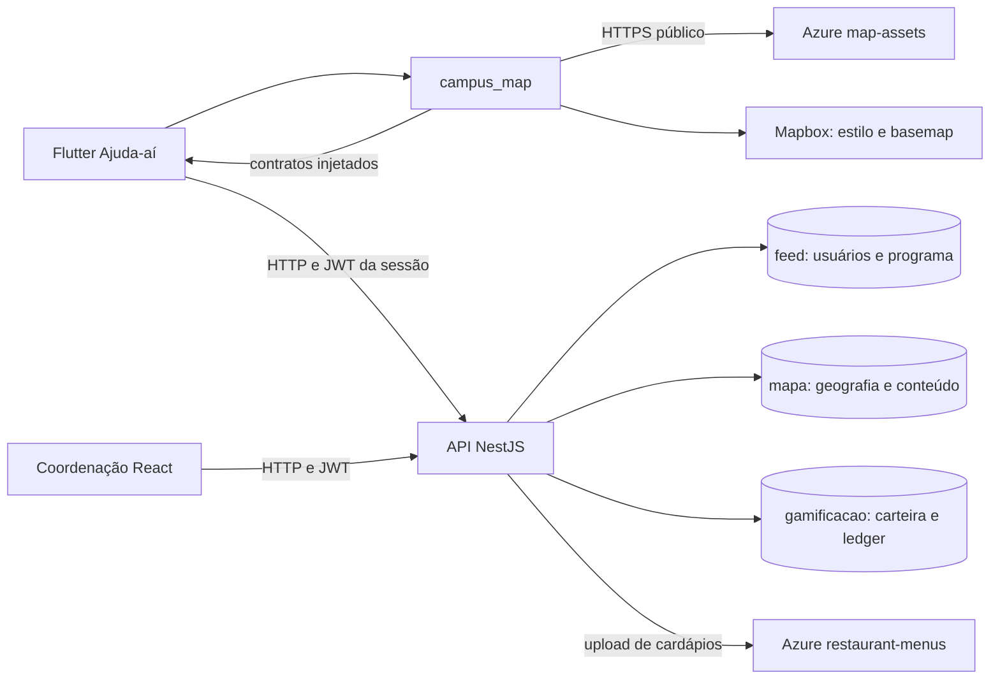

# Arquitetura técnica

O Ajuda-aí reúne os domínios do programa de apadrinhamento e do campus em uma
API NestJS. Identidade e sessão pertencem ao aplicativo principal; o mapa é um
pacote Flutter interno e usa serviços injetados pelo app. A coordenação usa React.

## Responsabilidades

- **Flutter:** `MapaPage` conecta navegação, sessão e adaptadores HTTP do app
  aos contratos de `campus_map`. O pacote contém renderer, interação e modelos,
  sem login, URL de API ou cliente HTTP próprios.
- **NestJS:** `MapaModule` lê a versão geográfica ativa e calcula rotas em
  memória; `CampusModule` administra eventos, restaurantes e cardápios;
  `GamificacaoModule` concentra XP e coleta de PucStops.
- **PostgreSQL/PostGIS:** `feed` é o schema padrão configurável por
  `DB_SCHEMA`; `mapa` e `gamificacao` têm migrations próprias. Os serviços
  desses domínios usam SQL parametrizado; suas entidades geográficas não são
  registradas no runtime para `synchronize`.
- **Mapbox:** renderiza o basemap e as camadas do campus. Logo e atribuição
  permanecem visíveis; o cliente recebe somente token público.
- **Azure Blob Storage:** GLBs versionados são lidos diretamente por HTTPS.
  O backend medeia uploads de cardápios. Containers privados usam chaves
  persistentes e SAS curtas; containers públicos usam URLs sem SAS.

## Fronteiras e falhas

JWT e papéis são verificados na API. Coleta deriva o usuário do token; a posição
não é histórico de usuário. [Identidade](decisoes/ADR-0001-identidade-central.md),
[XP](gamificacao/xp.md) e [PucStops](mapa/pucstops.md) detalham essas invariantes.

Footprints e manifesto locais sustentam o renderer; a busca remota tem fallback
local. Rotas, coleta e conteúdo dinâmico dependem da API. O 3D depende da rede ou
do cache do SDK; não há garantia de mapa completo offline.

[Setup](mapa/setup-mobile.md), [migrations](banco/migrations.md) e
[infraestrutura](infraestrutura/evolucao.md) concentram configuração e operação.
Os diagramas de dados estão em [dados geoespaciais](mapa/dados-geo.md#banco-geográfico-schema-mapa).
