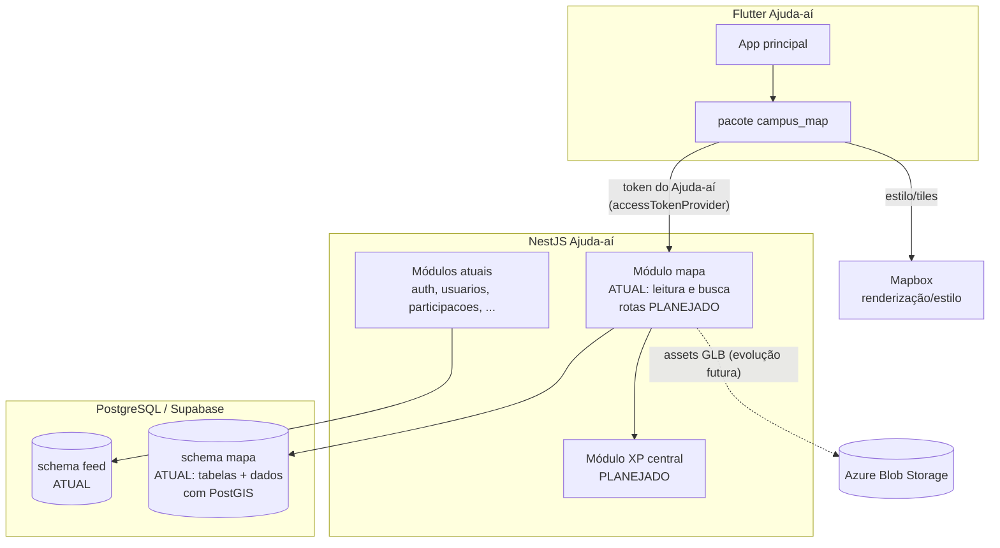

# Arquitetura técnica

> Estado: ATUAL (seção "Arquitetura atual") + PLANEJADO (seção "Arquitetura-alvo da integração")

## Arquitetura atual

Confirmado em código nesta branch (`feat/integracao-mapa`).

### Backend — `code/back/api`

- NestJS 12, projeto ESM (`"type": "module"`, imports terminam em `.js`).
- TypeORM ^1.x com `@nestjs/typeorm`, driver `pg`.
- Banco: PostgreSQL via Supabase, schema padrão `feed` (`DB_SCHEMA`) e schema
  `mapa` com PostGIS (Tarefa 7; aplicado no banco local e no Supabase).
- `DB_SYNCHRONIZE` é controlado por `src/config/seguranca.ts`, que só permite `synchronize`/seed de demo em host local e fora de produção.
- Migrations: baseline de `feed` (reconhece bancos criados por `synchronize`),
  a incremental `UsuariosERequisitosPadrinho`, PostGIS/`unaccent` + schema
  `mapa` e tabelas de `mapa`. Ver [banco/migrations.md](banco/migrations.md).
- Domínio de mapa: `MapaModule` (`src/mapa/`) com API pública de leitura
  (`/mapa/versao`, `/mapa/predios`, `/mapa/areas`, `/mapa/salas`,
  `/mapa/busca`; ver [mapa/api.md](mapa/api.md)), entidades em
  `src/mapa/entities` e importador em `src/mapa/importacao`
  (`npm run mapa:importar`). TypeORM runtime com `installExtensions: false`.
- Autenticação: login Microsoft (Entra ID) verificado por JWKS remoto (`jose`), mais um modo demo controlado por `AUTH_DEMO_ENABLED`. Token da aplicação é JWT HS256 de 1 hora, sem refresh.
- Armazenamento de arquivos: Azure Blob Storage (`@azure/storage-blob`), com containers públicos (`map-assets`, `restaurant-menus`) e privados (`profiles`, `feed`, `chat`).
- Testes: Vitest + Supertest.

### Mobile — `code/mobile`

- Flutter, pacote `ajuda_ai`, `applicationId br.pucminas.ajuda_ai`.
- SDK mínimo `^3.13.0` / Flutter `>=3.47.0`.
- Sem gerenciador de estado dedicado (singleton + `ValueNotifier`), sem roteador dedicado (`Navigator`/`MaterialPageRoute` imperativos).
- Sessão (`lib/sessao_usuario.dart`) é mantida **somente em memória**; não há persistência local nem renovação automática de token.
- Plataformas presentes no repositório: Android e Web. Não existe pasta `ios/`.
- Aba "Mapa" já existe na navegação (`lib/tela_mapa.dart`), hoje como placeholder ("Mapa em breve").

### Web — `code/front`

- React 19 + React Router 7 + Vite 7.
- Sem biblioteca de mapa.

### Infraestrutura local

- `code/docker-compose.yml` sobe `postgis/postgis:16-3.5-alpine` (PostgreSQL
  16 + PostGIS 3.5), com `search_path` igual ao do Supabase e sem o init
  automático de extensões da imagem (`code/postgres-init/`).

## Papel do Mapbox

Mapbox é o motor de renderização de mapa escolhido para a integração (decisão herdada do PUCMaps, mantida). O token de acesso e a URL do estilo devem ser fornecidos por configuração externa (`--dart-define`), nunca hardcoded, e a atribuição/logo do Mapbox deve ser mantida conforme os termos de uso. Ver [ADR-0004](decisoes/ADR-0004-campus-map-package.md) e [mapa/setup-mobile.md](mapa/setup-mobile.md).

## Arquitetura-alvo da integração (PLANEJADO)

Pontos confirmados desta arquitetura-alvo:

- O pacote `campus_map` não tem login próprio; recebe um `accessTokenProvider` do app principal. Ver [ADR-0001](decisoes/ADR-0001-identidade-central.md).
- O módulo de mapa no backend é novo, dentro do mesmo NestJS — não há um segundo backend. Ver [ADR-0004](decisoes/ADR-0004-campus-map-package.md) e [origem-pucmaps.md](origem-pucmaps.md).
- O schema `mapa` e o PostGIS existem (Tarefa 7); falta o módulo HTTP que os expõe. Ver [ADR-0005](decisoes/ADR-0005-schema-mapa-postgis.md) e [banco/migrations.md](banco/migrations.md).
- XP é central e novo, não uma migração do `user_stats`/`xp_log` do PUCMaps. Ver [ADR-0002](decisoes/ADR-0002-xp-central.md) e [gamificacao/xp.md](gamificacao/xp.md).
- Os GLBs ficam embutidos no pacote inicialmente; o Azure `map-assets` é evolução futura. Ver [ADR-0006](decisoes/ADR-0006-assets-3d.md).

Nesta seção, só o schema `mapa` (tabelas e dados) está implementado; os módulos
de backend continuam `PLANEJADO` até que o código correspondente exista.
