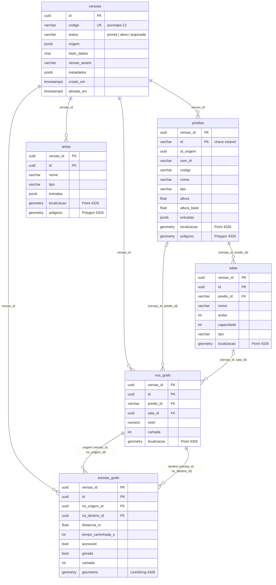

# Dados geoespaciais

O backend usa dados geográficos versionados no schema `mapa`.
O pacote Flutter contém footprints para renderização e fallback local.
Ambos usam WGS84 (SRID 4326), coordenadas GeoJSON em `[longitude, latitude]`.
[Origem e créditos](../origem-pucmaps.md), [migrations](../banco/migrations.md).

## Banco geográfico (schema `mapa`)



### Invariantes

- Chave de dados geográficos é `(versao_id, id)`; FKs compostas impedem
  referências entre versões. Exclusões usam `RESTRICT`.
- Prédios usam ID estável do footprint; portões sem polígono usam
  `GATE_<código OSM>`. Código/nome não são únicos nem servem de chave.
- `id_origem` preserva rastreabilidade da origem, sem substituir a chave estável.
  Áreas/salas e grafo preservam os UUIDs da fonte.
- Geometrias têm tipo fixo e SRID, com checagem de validade e índices GIST.
- Arestas são dirigidas, com distância, tempo, acessibilidade e camada.
  Distância zero não significa custo de tempo zero.
- Há no máximo uma versão `ativa`; as demais são `pronta` ou `arquivada`.
  Código já importado é imutável por hash.
- `versao_assets` é metadado de associação; o app resolve os GLBs pela versão
  do manifesto empacotado, sem atualização automática pelo banco.

As entidades em `code/back/api/src/mapa/entities/` apoiam ferramentas e
validação de schema; o runtime usa SQL e não as registra para `synchronize`.

## Importador

Em `code/back/api`, usando as variáveis `DB_*` do alvo:

```powershell
npm run mapa:importar -- scripts/mapa/dados/pucmaps-12.json
npm run mapa:importar -- scripts/mapa/dados/pucmaps-12.json --ativar
npm run mapa:importar -- --relatorio
```

Banco remoto exige `--confirmar-remoto`. Alvo é exibido sem senha;
o comando não executa migrations nem `synchronize`.

O snapshot é validado antes da conexão: formato, IDs, referências,
custos, geometrias, WGS84 e `hashDados`.
A importação trava `mapa.versoes` e insere tudo em uma transação.

- Código novo: insere e verifica contagens.
- Mesmo código/hash: não reescreve dados; confere o conteúdo esperado.
- Mesmo código com outro hash: recusa; gerar outra versão.
- `--ativar`: ativa a versão e arquiva a anterior na mesma transação.

O relatório permite inspecionar contagens e inconsistências do alvo sem
depender de números registrados numa execução anterior.

## Proveniência do snapshot `pucmaps-12`

Artefato fixo em `code/back/api/scripts/mapa/dados/pucmaps-12.json`,
gerado da versão 12 do PUCMaps e dos footprints do pacote.
Suas contagens de referência são 101 prédios, 12 áreas, nenhuma sala,
653 nós e 1.654 arestas dirigidas. São propriedades desse arquivo, não
uma afirmação sobre o conteúdo de produção.

O exportador `scripts/mapa/exportar-pucmaps.mjs` é mantido para reprodução:
lê somente banco local PUCMaps, em transação de leitura, com `PUCMAPS_DB_*`.
`npm run mapa:exportar-pucmaps -- --versao 12 --saida <arquivo.json>`
compila antes de executar. O cabeçalho do script documenta as variáveis.

Transformações importantes:

- Geometria do footprint preservada por ID; metadados complementares vêm da origem.
- Portões sem footprint permanecem pontos; footprints sem registro recebem
  apenas seus dados disponíveis, sem inventar categoria.
- Linhas degeneradas de conectores com distância zero viram geometria nula;
  nós, direção e custo de tempo permanecem. Linha inválida com distância positiva
  é recusada.
- Não se inferem salas, descrição ou geometrias ausentes.

## Footprints locais do Flutter

`code/mobile/packages/campus_map/assets/data/campus_footprints.geojson`
deriva das footprints e metadados de `campus_chunks.json` da origem:
ID, nome/código, alturas e coordenadas são preservados; `osmId`, `apiId`
e centro são unidos pelo ID exato, sem heurística por proximidade/nome.

Organização de chunks, materiais e métricas de GLB não pertencem ao GeoJSON.
O manifesto 3D mantém vínculo e cor de parede; não duplica a geometria.
Metadados OpenStreetMap/ODbL e atribuição permanecem no asset.

`LocalCampusDataSource` centraliza a leitura do bundle.
`CampusSnapshot` valida identidade, anéis fechados e coordenadas finitas,
com listas/propriedades imutáveis. O parser aceita Polygon/MultiPolygon.
O bbox orienta a câmera, sem representar limite administrativo.
A fonte local não consulta o backend; busca remota é responsabilidade de outro
repositório, com [fallback local](busca-localizacao.md#fonte-remota-e-fallback).

Não se devem acrescentar áreas/salas/categorias por inferência de nomes.
A fonte remota lê esses domínios da versão ativa.
Testes de snapshot/importação e `test/mapa-banco.integration.spec.ts`
protegem integridade, idempotência e rollback.
